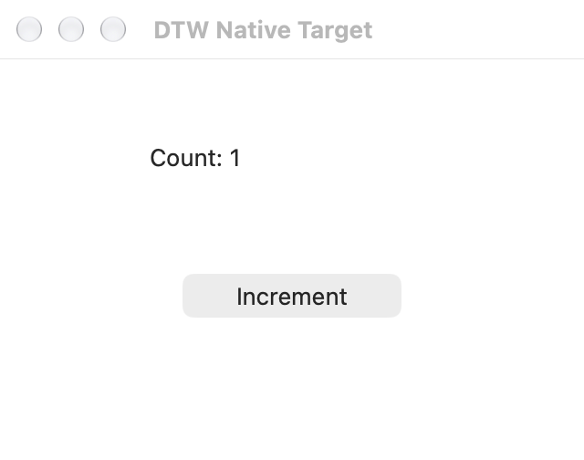

# app + source 接口验收

日期：2026-10-28。源码提交 `d6bccad22d579feae8e03f395d1de9d844c51f8d`，基于 #61 与本分支的多 app 骨架。本报告及证据在后续文档提交记录，未修改已测运行代码。

正常入口为 `exec({app, source})`。DTW 在接受执行时生成标识，模型不用编造或维护 `request_id`；旧字段直接拒绝。`result({app})` 查询此 MCP 连接该 app 最近接受的执行，可选返回的 `execution_id` 查询指定历史记录。正常调用同步等待，无需轮询。

最近接受不等于最后尝试；未收到或拒绝的新调用可能留下较旧记录。不同新调用即使脚本相同也执行新工作，只有已接受执行的同一标准传输请求重送才复用原执行。不提供跨连接去重，也不把未知效果视为未发生。详见 [MCP 合同](app-protocol-v1.md)。

## 自动检查与真实 GUI

二进制 SHA-256：`a76ecf12f118b75851fa36d2473742be8dd2d763dad2d5e683156c926da28072`。

| 验证 | 结果 |
| --- | --- |
| Cargo `--all-targets --locked --offline` | 187 项库测试、4 项 CLI 测试通过 |
| `scripts/check-source.sh` | 版本、格式、41 项 Core、20 项 IPC、12 项 Python 负控通过 |
| 执行身份与恢复 | 原生派发前生成标识、活跃重复帧合并、完成帧重送、参数冲突、标准取消、失败/退出后的查询、跨 app/连接隔离、显式未知记录不回退 latest |
| 自有 AppKit 窗口，经普通 MCP | 一次语义 press 后独立计数 0→1；重送相同已完成帧没有再次 press；指定历史与最近记录查询保持原回执 |
| 同内容新调用 | 两个新 exec 执行相同 JSON state 增量，读到 1 和 2，标识不同；自动测试另验证原子动作派发两次 |
| 其余原生回归 | 指定窗口截图与坐标 click 独立读回 1→2、取消恢复、A→B→A state/refs 保留、两连接六次截图、关闭另一连接后继续截图均通过 |
| 清理 | 两个 MCP 及其 native worker、fixture 正常退出，无强制信号；后续专属路径进程检查无残留 |

GUI 命令为 `python3 tests/acceptance/standard_agent_probe.py --dtw /private/tmp/dtw-standard-agent-target/debug/dtw --output /private/tmp/dtw-app-source-gui-20261028 --pixel-click`。单次验收通过，含 fixture 准备和清理共 15.65 秒。原始记录在该目录的 `evidence.json` 和 `mcp.jsonl`；[脱敏摘要](evidence/app-source-20261028/summary.json)不收录用户运行中应用清单。

## Claude Code 普通 Agent 验收

Claude Code 2.1.312，实际初始化模型为 `codex/gpt-6.1-terra`。用 `scripts/stage-agent-plugin.py` 制作临时本地插件，经 `--plugin-dir`、`--strict-mcp-config` 和普通 Skill 加载；未修改用户安装配置。仅授权操作专属 fixture 的 Increment 按钮一次，无定制 Host。

真实模型调用顺序：**Skill → apps → exec → exec**。两次 exec 的入参键都只有 `app`、`source`，分别调用 2、4 次脚本方法；没有模型生成的编号、结果轮询、失败重试或替代工具路线。模型先选窗/观察，随后再次观察、press 一次、独立观察 Count 0→1 并截图。fixture 自身的动作开始次数和计数均恰为 1；工具无错误，权限拒绝为 0。

CLI 报告整个模型流程 20.418 秒，其中 API 时间 18.921 秒；这不是纯原生工具耗时，也不是跨应用性能基准。CLI 与 fixture 退出码均为 0，专属路径进程检查无残留。完整本地记录：`/private/tmp/dtw-app-source-claude-20261028/agent.jsonl`、`evidence.json`。已核对真实工具参数、结果与图像，未仅采用模型最后的自述。

本轮未重跑 agy、公开发行包、TextEdit Space/闭窗矩阵或后台/锁屏新路线。原生 Swift 实现没有变更，其纯逻辑及 worker 生命周期专项证据见[先前骨架验收](multi-app-foundation-acceptance.md)。完整步骤账本仍在默认输出中，后续简洁投影工作不包含在本次接口简化里。CI 沿用两项轻量检查，没有增加完整 CUA 构建。

## 内容保真回归补充

后续仅新增两项 JSON/脚本回归及文档/Skill 说明，未修改运行代码。完整本地检查现为 189 项库测试、4 项 CLI 测试，轻量源码检查继续通过。测试覆盖实际 MCP 帧解码 → 工具分发 → QuickJS → JSON 返回的引号、反斜杠、正则、模板字符串、LF/CRLF、中文/emoji、Unicode 转义和控制字符；另保留合法 JSON 因少转义一层而改变脚本含义的负例。它证明内容链路不会二次解码，不能证明模型永不写错转义。

本次构建的二进制 SHA-256 与上述 GUI/Claude 记录一致，未重复真实 GUI。文件读取便利层与官方 rmcp 迁入仍是已明确方向，尚未实现；首版聚焦本地 stdio，远程不作本轮验收条件。
