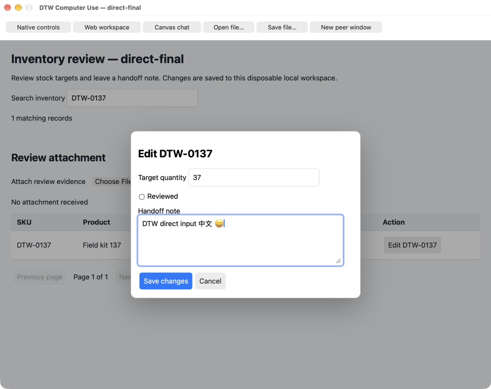
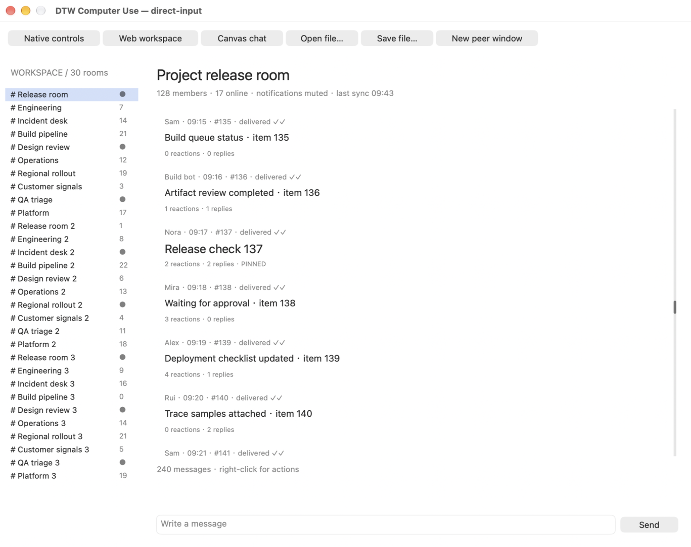

# 直接输入策略与可用性修复验收

日期：2026-11-17。源码基线 `ac90e69 / 0.5.1`，本轮为工作区实现与冻结候选验证，未提交、发布或替换当前连接的安装插件。上一轮[问题与规划](dtw-next-optimization-plan-2026-11-17.md)及证据保持原样。

## 最终行为

- macOS 优先使用有效后台能力；必须使用前台／真实鼠标时直接操作，完成后保留操作后的状态。
- Windows 默认前台交互。执行结束不恢复原前台、焦点、鼠标或窗口层级。
- 两端删除用于归还的原状态快照、恢复动作及借还回执；继续保留精确进程／表面／控件证明、用户切走停止、键鼠配对释放和 unknown 不重放。
- `apps`、`exec` 和 14 个 app 操作的调用参数保持。`InputDelivery` 仅保留 `route`／`reason`；移除 `FocusReturn`、`foreground_borrowed` 和 `focus_return` 等旧诊断合同，生成的内部 TypeScript fixture 同步更新。

## 关键改动

| 范围 | 结果 |
| --- | --- |
| macOS native／transport | 移除原前台、原指针、窗口层级和后台 key window 的保存／恢复；执行结束只停止 scope 观察并清理输入资源。后台 first-mouse／原生键盘能力判断继续在 payload 前完成 |
| Windows scope／input | 移除前台和鼠标借还、`return_focus`、cursor 原始／末次位置与相关分支；scope finish 只清状态。UIA、键盘和指针仍先准备精确前台接收者；显式正常关闭使用既有生命周期协议 |
| 精确文本 receiver | editable semantic click 优先选择原生聚焦，AXPress 不再绕过文本接收者验证；确认 retained exact receiver 后才继续顺序输入。普通原生控件保留后台路线，Web 文本控件必要时在聚焦派发前准备前台 |
| 回执 | positive native reply 与后置读回分开：已知 `dispatched` 可以同时携带后置错误，不能被解析成无效观察或伪造成功；未确定派发仍是 `unknown`，不自动换路重投 |
| 自绘弹层 | 对已验证 root 的确切 `AXUnknown` subrole，不套普通窗口必须成为 key 的 first-mouse 启发式；仍走既有精确 window-addressed pointer 路线和 Scene 像素命中证明。普通 `AXStandardWindow`、文件面板专用路由及 keyboard 合同保持 |
| 工具与 Skill | 重复 selector 提示改为候选 ID／上下文／图像；说明两工具包含全部 14 操作、atomic 共 15 工具、空 AX 完整性、setter 与输入事件区别、receipt／view／custom result、completed 与成功区别；统一 cleanup 新请求恢复口径 |

## 实机证据

环境为 macOS 27.2 / 26B123、arm64。冻结候选路径 `/tmp/dtw-direct-candidate-20261117-02/dtw`，SHA-256：

```text
259b92ff8a0ef14b8314844c3fd618c0a919d158443a1361ee9e31d453cb2a67
```

使用自有 AppKit ComputerUse 工作台、其中的 WKWebView 库存页，以及独立前台见证应用。所有操作经候选的真实 stdio MCP `apps`／`exec`；业务效果由 fixture 日志、库存文件、截图和只读窗口顺序观察器独立核对。最终成功运行的 12 次 exec 没有工具错误，`passed=true / clean_run=true`。

[结构化摘要](evidence/direct-input-policy-2026-11-17/summary.json)保存候选、端点、独立效果、清理与失败分类；[回执](evidence/direct-input-policy-2026-11-17/receipts.json)保留成功运行、Pin、首个候选失败和服务中断的实际请求／结果，不含 MCP 图片 base64。两张原 PNG 已归档，并在摘要中记录 SHA-256。

| 场景 | 独立结果 |
| --- | --- |
| 原生后台操作 | 见证应用保持前台：PID 6963 → 6963；物理鼠标保持 `[1467.390625,1525.56640625]`；两窗口相对顺序保持 `[见证 6963,目标 6948]`。Native note 替换及提交效果正确 |
| Web 文本输入 | semantic click Handoff note 后输入 `DTW direct input 中文 😀`；备注读回正确，数量仍为 `37`。随后一次保存成功，其他 239 条库存记录不变，日志只有一次新保存 |
| 必要真实 hover | 准备后前台从见证 PID 6963 变为目标 PID 6948；调用结算后仍为目标。物理鼠标从 `[1467.390625,1525.56640625]` 留在 hover 目标 `[516.5,1377]`；相对层级成为 `[目标,见证]`，未归还 |
| 自绘 Pin | 从实际 DTW 截图选择坐标，只点击一次。message-137 显示 `PINNED`；日志为 `pin_count=1 / pinned=message-137 / selected_action=Pin`，菜单已关闭，`pressed_mouse_buttons=0` |
| 正常结束 | 主目标正常 quit，`view.running=false`。见证与旧自有测试应用也经正常 quit 关闭；MCP returncode 0、无 forced 清理、native workers 已回收，HTTP 服务正常停止 |

文本 receiver 截图：



自绘菜单效果：



这里的前台、鼠标和层级数据是操作前后的端点观察，不能据此推出所有中间时刻都无变化。hover 坐标来自自有 fixture 几何，映射到实际 DTW capture，属于直接脚本证据；Pin 坐标来自已查看的实际截图。

## 失败与审查记录

1. 默认 sandbox 中，候选启动返回 `launch_unconfirmed`，且 MCP 收尾的 `ps` 被拒绝。保留 unknown 启动回执；未派发键盘／鼠标 payload。GUI 验证改在经审批的 Host 路由执行。
2. 首个候选在 Web 文本后台聚焦后未能确认 receiver，成功阻止后续输入，但 parser 又把 `dispatched + error` 误判成 `InvalidObservation`。据此修复 Web 的派发前前台准备和回执解析，未重放该聚焦动作。
3. 中间一次探针已经正确读回备注和数量，但保存等待超时；独立 HTTP GET 确认为本地 fixture 服务已退出、端口拒绝连接。失败与后续键盘诊断均保留；把服务和探针放在同一有限生命周期后，新的完整运行一次保存成功。
4. 一次并行 Rust 运行中，未修改的 cursor helper 清理时序测试失败；完整串行复验通过，未放宽断言。真实 HID event-source 用例在 sandbox 创建源时挂起，单独 Host 精确运行通过，未修改测试。
5. 独立审查指出两个实现期回归，均已修复：聚焦后读回失败不能抹掉 positive native dispatch；已证明的原生文件面板点击仍要标记 resident input admission，以允许合法的关闭／新文档转换。可选 panel metadata 不阻断普通点击，普通 read／guard 不产生此标记。

自绘弹层的只读 AX 证据为 `AXWindow / AXUnknown / parent AXApplication`，未证明 NSWindow parent 关系。修复没有使用同 PID 或层级推断 parent，也没有放宽 keyboard、`focused()`、可见命中、配对释放和不重放合同。独立审查未发现剩余 blocking finding。

## 验证与边界

- Rust 库测试：678 项串行通过；剩余真实 HID modifier 用例在 Host 精确运行 1 项通过，合计 679 项覆盖。CLI 6 项、MCP stdio 3 项通过。
- 原生 inventory／surface／AX／窗口焦点合同通过，包含新增的 `AXUnknown`／`AXStandardWindow` 指针分类；原生输入合同通过，包含配对释放、取消、生命周期与 bounded shutdown。
- `scripts/check-source.sh` 及新探针独立 oracle 的 3 项测试通过；生成 TypeScript fixture 保持原生成比对断言。
- Windows `x86_64-pc-windows-msvc` provider 的生产代码与测试类型检查通过；纯状态转换 4 项通过。本机完整 Windows QuickJS 交叉构建受 C 工具链限制，未进行 Windows GUI 验收。
- 未宣称 Linux、任意应用、多屏／混合 DPI、锁屏或完整模型／Skill 任务基准通过。历史借还策略报告与 runner 聚合指标不能直接当成本轮策略通过。

定向入口为 [direct_input_probe.py](../tests/acceptance/direct_input_probe.py)。其 oracle 同时检查目标内容、邻接记录和提交次数；失败时保留原回执，未知输入不重投。复现方法见[构建与验证](building.md)。验收后只清理遗留注释及一处诊断标签；当前连接的已安装插件仍保持原版本。
