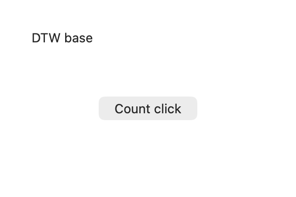

# Issue #49: native discovery and exact-window observation

First-batch implementation and macOS acceptance, 2026-10-27. Tracks
[#49](https://github.com/caelis-labs/desktop-world/issues/49); the focus recovery
and AX readiness work is documented in the subsequent
[second-batch report](issue49-native-recovery.md).

## Contract

- `apps` returns running apps by default, with optional name/bundle query,
  installed-app inclusion, limit and offset. Filtering occurs after CUA enumeration.
- `windows` requires a PID or app filter, optionally filters titles/visibility,
  and retains distinct IDs for duplicate titles. Layer hints describe stacking,
  not an inferred main-window or AX role. Results are deterministically ordered,
  not sorted by presumed importance. Inspect `z_index` for native stacking evidence.
- Both return bounded model-facing pages with totals and continuation. Continuation
  re-enumerates live state; the original full native inventory remains in the
  receipt's structured page. Long display labels are explicitly marked abbreviated.
- `observe` requires an exact PID/window. CUA is asked for both tree representations
  and verbose metadata with explicit 250-node / 25-depth defaults, screenshot off.
  It uses `tree_format:both`, not `full_output`, so it retains the default narrow
  menu traversal. Only the summary projects one tree; native elements, snapshots,
  diagnostics and optional images remain retrievable from the original receipt.
  Arbitrary script-returned JSON is not rewritten.
- `app` accepts `window_id`. It selects within the attributed visible inventory
  before capturing exactly one frame. An absent target fails without fallback.
  Without an ID, the existing front-to-back image limit is unchanged. The summary
  now directly exposes frames, selection, candidates and omitted count.
- Exact capture keeps the **full** scene inventory for stale-binding and occlusion
  checks. New observations still invalidate earlier bindings; receipt reads do not.
- The new native routes use the existing session/authorization/queue. Bounded
  manifests continue to gate native tools; the custom SCK route remains unavailable
  in bounded mode. No CUA SDK/worker upgrade or automatic input retry is introduced.

## Verification

The source and dependency baseline is DTW main `d97b69c93b5a9d26a1470fbbbe7c2996f6f148d1`.
CUA remains at component **0.38.0**, source
`85e2b1318bd77ccf3cfa88ccdf875a4bb7eaed19`. Its existing local worker was reused;
this is an adapter validation, not a fresh upstream build or release certification.

Local checks passed:

- Rust: 22 tests, plus the explicitly enabled native idle/cancellation/expiry test.
- `scripts/check-source.sh`: formatting, Python checks, TypeScript contracts and
  70 pinned-prelude checks. The first run encountered a private npm mirror 404;
  rerunning with an empty user config and the public registry resolved that setup
  failure without changing dependency versions.
- MCP smoke, script contract, click contract, native tools, new observation
  contract, authorization, runtime, lifecycle and native-helper lifecycle probes.
- Real macOS GUI: `observation_gui_probe.py`, using the task-owned AppKit scene
  application with one ordinary-layer window and two elevated windows.
- Existing `scene_fixture_probe.py`: ordinary/elevated captures and clicks, consumed
  bindings, moved/closed windows, intervening scripts, unrelated opaque occlusion,
  and actual 30-second binding expiry.

The new GUI probe independently checks:

| Scenario | Observed result |
| --- | --- |
| Running apps, installed apps, filtering and two-item pages | Correct totals/filtering; full installed-app summary remained below 12 KiB |
| Three-window inventory | All three IDs and layer hints returned |
| Default `max_windows:1` | Captured the upper floating window, as documented |
| Exact base-window ID with `max_windows:8` | One base-window frame, all three candidates retained, omitted count 2 |
| Screenshot-bound click | Independent fixture counter increased once; native event window ID matched the selected base window |
| Two identical window titles | Both distinct window IDs retained |
| Hidden / nonexistent requested ID | Refused without capturing another window |
| Exact capture, then another window moves | Stale binding refused; fixture counter unchanged |
| Exact AX observation | One summary tree; full native elements and snapshot retained |
| User script with `text`, `tree_markdown`, `elements` fields | Original returned object unchanged |



The first GUI run exposed CUA's default omission of `elements`; the adapter now
requests both representations, and the corrected route passed the final GUI run.
A subsequent test launch raced fixture startup; the probe now waits for the
fixture's state file with a ten-second bound. Original failed-run evidence is
retained locally alongside successful runs.

These are **real GUI operations against a controlled native test application**,
not a claim that every third-party app or the original reported application has
been revalidated. Windows GUI, browser-specific flows, focus recovery, and AX
readiness polling are outside this acceptance. Cross-platform package/contract
CI is separate from live Windows GUI acceptance.

## Reproduce

Build an adapter with the pinned worker, then use new output directories:

```sh
sh tests/fixtures/scene/build-run.sh /private/tmp/dtw49-scene
DTW_CUA_WORKER=/path/to/pinned/cua-driver \
  python3 tests/acceptance/observation_gui_probe.py \
  /path/to/dtw /private/tmp/dtw49-scene /private/tmp/dtw49-evidence
DTW_CUA_WORKER=/path/to/pinned/cua-driver \
  python3 tests/acceptance/scene_fixture_probe.py \
  /path/to/dtw /private/tmp/dtw49-scene /private/tmp/dtw49-regression
```

The probe stores original receipts, full native data, fixture-only PNGs and its
summary. Keep this evidence private: application discovery includes local app
inventory. End the task-owned fixture by writing `quit` to its command file.
