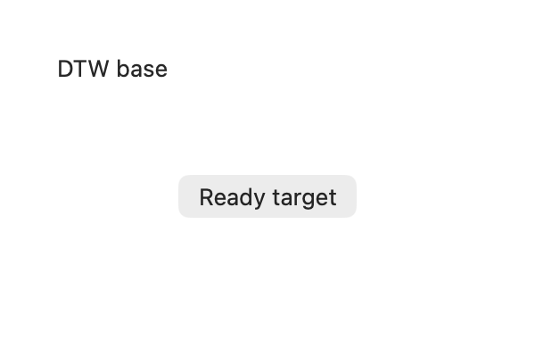

# Issue #49: native focus recovery and bounded AX readiness

> Historical evidence: this report applies only to its named source revision, binary and entry point. The current product uses [standard MCP and explicit app IDs](app-protocol-v1.md); any grant, manifest, SDK/worker or custom Host setup below is superseded and is not a current installation instruction. No acceptance result here is claimed to have been rerun for the new entry.

Second batch after [#50](https://github.com/caelis-labs/desktop-world/pull/50),
merged as `26247c4998bb31ce334930a80616711f11381ebf`. Tracks
[#49](https://github.com/caelis-labs/desktop-world/issues/49). CUA stays at 0.38.0,
source `85e2b1318bd77ccf3cfa88ccdf875a4bb7eaed19`; no upstream patch or worker upgrade.

## Contract

`focus` keeps the native fields, error status and error code, and adds
`dtw_recovery`. Exact-window verification requires explicit native evidence;
process activation alone is insufficient. An unverified result includes a
ready-to-call `windows` request scoped to the same PID. Reconcile the original
window ID, title and visibility before further action. Hidden windows may need
user restoration. DTW does not retry focus, select an alternative or replay input.
Native recovery instructions are still adapted, but DTW's own recovery metadata
is attached afterwards so its valid operation and specific hint remain intact.

`observe` is still a single exact-window read unless `ready_when` is supplied:

```json
{"operation":"observe","arguments":{"pid":123,"window_id":456,"ready_when":"Save changes","ready_timeout_ms":2000}}
```

The condition is a case-insensitive substring in a returned AX element's
label/name/value/text. Window/application roots and menu elements are excluded.
This means only that the specified content was observed; it is not a test of
whole-application readiness or AX support. Queries, depth/node limits and upstream
truncation can hide a condition. Empty trees and missing matches are never called
unsupported accessibility.

Polling uses the existing authorized, serialized native session and exact target.
It waits up to 250 ms between reads, with a default 2000 ms scheduling budget,
maximum 5000 ms and at most 20 reads. Zero requests one read. Each positive-budget
read's AX traversal timeout is capped at 1000 ms and the remaining budget. An
already-started native call may finish after the budget; this is not a hard wall
clock guarantee. A native tool error, screen-lock or permission-denied diagnostic
stops polling. Transport failures retain the existing runtime error behavior.
Cancellation uses the existing runtime termination contract, including an unknown
outcome and refusal of subsequent dispatch after an interrupted operation.

The final native snapshot is retained, with additive `dtw_readiness` metadata:
`matched`, `not_observed` or `blocked`, expected content, elapsed time, budget,
attempt count and per-read diagnostic samples. Samples contain no old element
tokens or trees. Only final-snapshot tokens may be used afterwards. Full native
structure and optional images remain in the receipt. Large summaries retain the
final readiness state and explicit access to full evidence; sample details may
be omitted from that summary. Ordinary scripts are unaffected.

## Verification on macOS, 2026-10-27

The existing pinned local worker was reused, so this validates DTW's adapter,
not a new CUA build or release artifact. Local checks passed:

- 26 Rust tests plus the explicitly enabled native idle/cancellation/expiry test.
- Source checks: formatting, Python checks, TypeScript contract and 70 pinned
  prelude cases.
- Nine MCP/script/click/native-tools/observation/authorization/runtime/lifecycle
  and native-helper probes.
- First-batch real GUI observation regression, including independent counter and
  exact event-window verification for clicks.
- Existing real GUI scene regression: ordinary/elevated capture and input,
  consumed/stale bindings, moved/closed windows, intervening scripts, external
  opaque occlusion and actual 30-second expiry.
- New `recovery_gui_probe.py` against the task-owned AppKit application:

| Scenario | Evidence |
| --- | --- |
| Visible button before AX content | Screenshot shows Ready target; window intentionally exposes no AX children; one-read status is not_observed |
| Delayed AX content | Multiple exact-window reads, then matched after the fixture exposes children; final raw snapshot matches summary |
| Missing expected text | Bounded not_observed result, no unsupported-AX claim |
| Window title as condition | Does not count as loaded content |
| Hidden ordinary window focus | Native bring_to_front_exact_window_unverified and partial status retained; windows recovery call executes successfully |
| Missing exact window | First native error stops polling with blocked status |
| Cancellation during wait | Existing unknown-outcome receipt; fixture click count unchanged |



The fixture overrides its window's AX children, leaving the pixels unchanged.
An initial attempt to hide only the button's accessibility-element flag did not
hide it from CUA traversal and was replaced. The first focus test also exposed
DTW's generic recovery adapter overwriting its own windows call with describe;
that defect is fixed and unit/GUI covered. An existing click regression correctly
refused a genuinely occluded point; it passed after a fresh fixture launch.
The opt-in native test was initially invoked without its required DTW_TEST_*
variables, then passed with the documented environment. Failed-run evidence is
retained alongside successful runs; none of these failures was suppressed.

This is real GUI acceptance of a controlled macOS fixture, not a revalidation of
all third-party applications or the original reported app. Windows GUI, real
permission denial/lock-screen scenarios and universal AX readiness detection are
not established by these tests. Platform package CI is separate.

## Reproduce

Build DTW with the pinned worker and use new output directories:

```sh
sh tests/fixtures/scene/build-run.sh /private/tmp/dtw49-recovery-scene
DTW_CUA_WORKER=/path/to/pinned/cua-driver \
  python3 tests/acceptance/recovery_gui_probe.py \
  /path/to/dtw /private/tmp/dtw49-recovery-scene /private/tmp/dtw49-recovery-evidence
```

The probe records original receipts, full final native data, fixture-only PNGs
and its summary, and restores the fixture before exit. End the task-owned fixture
by writing `quit` to its command file. Keep full local evidence private because
native scene diagnostics can include other desktop window identifiers.
