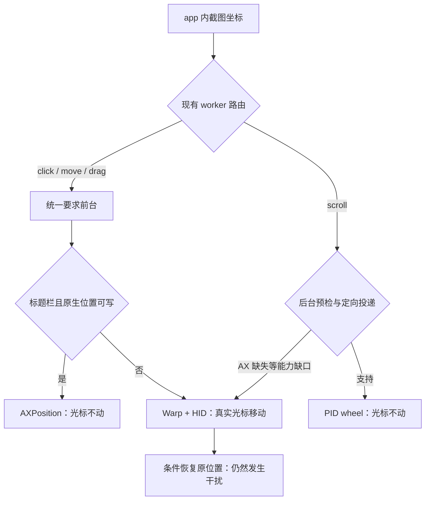

# macOS AX 与真实光标审查（2026-11-03）

本轮使用当前 `apps` / `exec` 协议、自建 AppKit 应用和固定开发二进制。
没有操作 Telegram 聊天、修改 Agent 安装或发布版本。Windows 未做 GUI 验收。

结论：当前真实光标干扰主要来自 DTW 的路由策略和未移植的能力，不能归为 macOS
统一的技术限制。独立光标尚未在产品中完成；实验成功也没有自动成为产品能力。

## 逐操作结论

“不干扰”要求操作及清理全程不移动系统光标，结束归位不算通过。

| 操作/边界 | 当前产品的观测 | 对应机制与判断 |
| --- | --- | --- |
| 语义 ID / selector 点击 | 未检测到位移 | AXPress；AX 可读性应独立判断 |
| 坐标左键 | 移过去，通常再归位 | worker 提前拒绝后台点击，Scene 明确 Warp + HID；实现策略 |
| 坐标右键 | 位移 | 同一物理点击路径；已有定向原语没有用于这条公开路径 |
| 坐标双击 | 位移 | 同一物理路径，两个有序 down/up；恢复不等于独立 |
| 悬停 `move` | 位移，部分调用未产生目标回调 | 一律物理路由；另有事件投递可靠性缺口，见下文 |
| 内容拖拽 | 起点 Warp，沿路径移动 | 后台 drag 尚未移植；不是已证实的系统限制 |
| AppKit 滑块拖拽 | 沿路径移动，滑块确实变化 | 仍走同一内容拖拽路径，可优先移植定向路径 |
| 遮挡中断拖拽 | 部分路径已经移动，随后释放 | 中断阻止后续输入，但不能撤销已经发生的真实光标位移 |
| 取消拖拽 | 已移动，随后释放；原请求可能无回复 | 独立跟踪取消至普通读恢复的清理区间；不伪造原派发回执 |
| 原生标题栏移动 | 窗口确实移动，未检测到光标位移 | AXPosition；但 worker 的 blanket drag 路由仍先要求前台 |
| AX 可用的锚点/默认滚动 | 未检测到位移，收到 wheel | 已有 PID 定向 wheel 路径 |
| AX children/window 不可用的滚动 | 位移，随后条件恢复 | AX 背景预检退到物理 wheel；可继续去掉不必要的语义依赖 |
| 字段聚焦点击后键盘输入 | 点击阶段位移；独立键盘调用未检测到位移 | 已分别拆开公共调用观察，不能把整段输入都称作不干扰 |
| `look` / `capture` / 自动启动 / quit / 无窗口快捷键 | 本轮未检测到位移 | 感知、生命周期和键盘路径没有 Warp |
| 过期坐标、跨窗口、空拖拽、background-only 拒绝 | 派发前拒绝，未检测到位移 | 原有拒绝边界保留，不用移除身份/几何/取消检查来换取可用性 |

所有产品 Warp 调用已逐处检查：

- `Scene.swift` 的坐标点击和内容手势；
- `Native.swift` 的前台滚动和 `releaseFocus` 条件恢复；
- 每条路径都还调用了系统鼠标关联接口，不能靠隐藏系统指针或画 overlay 宣称独立。
- 旧 `native-input` fixture 的 `park_pointer` 会主动 Warp，是测试布置，不是 DTW
  操作；它应单独标注，不能混进产品行为归因。旧 atomic/Session/result runners
  已不适用当前公开协议，本轮没有用它们冒充当前协议验收。

`worker.rs::background` 对 click/move/drag 的统一拒绝解释了大量位移。
`cua_input::Request` 只接 click/scroll/type_text/keypress，尚无 move/drag。
旧的注释以 popup 关闭后的 key-window 恢复困难为理由禁用了全部坐标点击：
这个局部清理问题不应该长期决定所有应用的公开输入路由。

## 独立光标的实机可行性

另建独立实验，向精确的自建 PID/window 投递事件，没有 Warp、全局 HID 或前台切换。
目标使用 `opaque` AX profile，另一个自建浮窗应用保持前台并遮住目标。结果：

| 单次定向投递 | 目标实际效果 | 系统光标采样 | 其他应用前台/输入 |
| --- | --- | --- | --- |
| public PID click | 按钮计数 +1 | 零位移 | 前台保持，没有收到点击 |
| public PID drag | down / drag / up 完整到达 | 零位移 | 前台保持，没有收到拖拽 |
| SkyLight PID click | 按钮计数 +1 | 零位移 | 前台保持，没有收到点击 |
| SkyLight PID drag | down / drag / up 完整到达 | 零位移 | 前台保持，没有收到拖拽 |
| 两种 transport 的 hover | 没有目标 hover 回调 | 零位移 | 前台保持，但不能算操作成功 |

两个 AppKit 应用同时报告 `active` 是定向本地激活造成的，不能据此宣称系统前台
发生变化或保持；实验另外读取 `NSWorkspace.frontmostApplication`。与目标事件
及源码没有 front-process 调用一起判断。真实光标由第三个进程采样。

这已证明“不碰真实光标的 AppKit 内容拖拽”可行。它没有证明所有应用、原生
drag-and-drop 会话、WebKit、Chromium 或悬停都已支持。实验不具备生产路径的全部
身份、截止时间、取消和清理保障，不直接替换产品路由。
[CUA 的原始验收矩阵](https://github.com/trycua/cua/blob/main/libs/cua-driver/docs/action-support.md)
也分别列出 AppKit PX 点击/滑块与系统拖放会话的边界，不能把其中一种成功外推到全部拖拽。

## 另一个待解决的真实缺口：悬停

固定产品二进制在 scene 首轮以及 AX 右键/双击后出现：`move` 返回已派发、真实光标
有移动，但是目标没有 hover 回调。scene 加入只读原始事件记录后的完整回归通过
40 项；这次通过不抹掉最初失败，也不能作为根因结案。

最终 AX 全矩阵跑完 43 项，42 项通过，`count-range:pointer_move` 失败；没有重放
悬停输入。`--continue-effect-gaps` 只允许继续审查后续操作，整轮仍返回失败。
不能用“CGEvent 已发送”、overlay 动了或最后截图没变替代目标效果证明。

## 本轮已落地的 AX 修复

- count/range 不支持时，回退到一次普通 `AXChildren` 取值，保持截止时间、类型检查、
  32768 子项上限和覆盖完整性检查；健康 provider 继续使用分页。
- optional accessibility opt-in 失败不再直接否定普通 AX 读取。
- 截图坐标、物理手势和前台键盘不再依赖 AXChildren / AXWindows。语义目标无法证明时
  返回图像，不自动把不确定的语义操作重放成坐标点击。
- 身份变化、过期几何、异属进程遮挡、权限、取消、成对释放仍保留独立检查。
- 自建直接子进程退出后可能暂为 zombie；用明确的 kernel SZOMB 记录确认退出，
  不把无法读取进程信息当作退出。

旧 v0.3.1 在同一 count-failure fixture 上的坐标点击被 `children_unavailable`
拒绝，新候选的对应功能已验证。真实 Telegram 尚未完成输入验收，不作该应用已全面
修复的承诺。开发候选保留原有物理路由，因此 AX 修复通过不代表光标独立已经完成。

## 覆盖、证据与后续顺序

独立观察器请求每 2ms 读取实际系统光标，逐调用保留实际采样间隔、最大位移和转折数。
结束归位仍计为移动；短于采样空隙的运动不能排除，位置本身也不能证明由谁触发。
本轮按明确的 Warp/HID 源码、目标效果和时间区间联合归因。

- 所有审查轮次共 296 个公开 exec 区间，62 个检测到位移，逐项列在下表。
- 当前三套完整矩阵合计 171 个区间，其中 33 个检测到位移。包含取消到读恢复的清理
  区间；该区间不代表原请求取得回复。
- scene 40 项、lifecycle 7 项通过；最终 AX 43 项中 1 项 hover 缺口保留为失败。
- Rust 509 library + 4 CLI + 3 MCP tests、纯原生控制、源码检查通过。新增 GUI
  诊断只在 CI 编译，不在普通 runner 操作桌面。
- 原始 MCP、fixture 日志、PNG、系统光标样本及失败均保留在本机私有临时证据目录。
  没有真实 Harness A/B、Windows GUI 或安装产物验收的含义。

最直接的施工顺序：

1. 在现有 app 授权和 worker 事务内，恢复有证据的定向坐标点击；正确处理 popup
   消失后的清理，不再统一禁用点击。原生窗口位置路由前移，避免先要求物理前台。
2. 移植单次定向内容/滑块拖拽，保留原始 owner、逐步验证和取消/释放保障；在同一
   事务中维护 Agent 虚拟坐标，外部仍然只用 `apps`、`exec`。
3. 单独解决 hover 路由和投递可靠性；验证 AX 缺失时的定向 wheel，去掉无关语义门槛。
4. 用现有逐操作观察器，把“目标效果成立 + 全程无系统光标位移 + 没有外部输入泄漏”
   一起作为完成标准。先覆盖当前全部分支，再扩展真实应用/系统拖放边界。

不能把结束恢复真实鼠标、全局解关联鼠标或多画一个光标作为以上工作的替代。

## 每一处检测到的真实光标变化

`A1/A2/A3` 为 AX 三轮，`S1/S2` 为 scene 两轮。完整矩阵为 A3、S2、lifecycle。
序号是原 MCP request ID，最大位移单位为系统屏幕 point；失败轮次也保留。
`cancel` 表示原请求没有回复，统计区间含到首次成功普通读的清理阶段。

| 轮次 | request | fixture | 操作 | 最大位移 | 首尾相同 |
| --- | ---: | --- | --- | ---: | --- |
| A1 | 7 | count-range | coordinate | 1203.019 | 否 |
| A1 | 9 | count-range | move | 1112.282 | 是 |
| A1 | 11 | count-range | drag | 1112.282 | 否 |
| A1 | 13 | count-range | coordinate | 312.410 | 是 |
| A1 | 29 | range | coordinate | 289.800 | 是 |
| A1 | 31 | range | move | 300.000 | 是 |
| A1 | 33 | range | drag | 300.000 | 是 |
| A1 | 35 | range | coordinate | 312.410 | 是 |
| A1 | 48 | opaque | coordinate | 289.800 | 是 |
| A1 | 50 | opaque | move | 300.000 | 是 |
| A1 | 52 | opaque | drag | 300.000 | 是 |
| A1 | 54 | opaque | coordinate | 312.410 | 是 |
| A1 | 59 | opaque | scroll | 300.000 | 是 |
| A1 | 60 | opaque | scroll | 174.230 | 是 |
| A1 | 67 | no-windows | coordinate | 289.800 | 是 |
| A1 | 69 | no-windows | move | 300.000 | 是 |
| A1 | 71 | no-windows | drag | 300.000 | 是 |
| A1 | 73 | no-windows | coordinate | 312.410 | 是 |
| A1 | 78 | no-windows | scroll | 300.000 | 是 |
| A1 | 79 | no-windows | scroll | 174.230 | 是 |
| S1 | 10 | scene | coordinate | 209.344 | 是 |
| S1 | 12 | scene | coordinate | 194.165 | 是 |
| S1 | 17 | scene | coordinate | 354.277 | 是 |
| S1 | 37 | scene | coordinate | 190.589 | 是 |
| S1 | 39 | scene | move | 392.588 | 是 |
| A2 | 7 | count-range | coordinate | 157.013 | 是 |
| A2 | 9 | count-range | right | 287.522 | 是 |
| A2 | 11 | count-range | double | 157.013 | 是 |
| A2 | 13 | count-range | move | 287.522 | 是 |
| S2 | 10 | scene | coordinate | 1469.907 | 否 |
| S2 | 12 | scene | coordinate | 1444.206 | 是 |
| S2 | 17 | scene | coordinate | 1575.663 | 是 |
| S2 | 37 | scene | coordinate | 1424.576 | 是 |
| S2 | 39 | scene | move | 1613.526 | 是 |
| S2 | 40 | scene | drag | 1613.526 | 否 |
| S2 | 43 | scene | drag | 280.000 | 否 |
| S2 | 45 | scene | drag | 348.558 | 否 |
| S2 | 56 | scene | coordinate | 80.443 | 否 |
| S2 | 61 | scene | click+keypress+typeText | 248.847 | 是 |
| S2 | 47 | scene | drag / cancel | 357.129 | 否 |
| A3 | 7 | count-range | coordinate | 157.013 | 是 |
| A3 | 9 | count-range | right | 287.522 | 是 |
| A3 | 11 | count-range | double | 157.013 | 是 |
| A3 | 13 | count-range | move | 287.522 | 是 |
| A3 | 15 | count-range | drag | 387.129 | 否 |
| A3 | 17 | count-range | coordinate | 312.410 | 是 |
| A3 | 33 | range | coordinate | 289.800 | 是 |
| A3 | 35 | range | move | 300.000 | 是 |
| A3 | 37 | range | drag | 300.000 | 是 |
| A3 | 39 | range | coordinate | 312.410 | 是 |
| A3 | 52 | opaque | coordinate | 289.800 | 是 |
| A3 | 54 | opaque | move | 300.000 | 是 |
| A3 | 56 | opaque | drag | 300.000 | 是 |
| A3 | 58 | opaque | coordinate | 312.410 | 是 |
| A3 | 63 | opaque | scroll | 300.000 | 是 |
| A3 | 64 | opaque | scroll | 174.230 | 是 |
| A3 | 71 | no-windows | coordinate | 289.800 | 是 |
| A3 | 73 | no-windows | move | 300.000 | 是 |
| A3 | 75 | no-windows | drag | 300.000 | 是 |
| A3 | 77 | no-windows | coordinate | 312.410 | 是 |
| A3 | 82 | no-windows | scroll | 300.000 | 是 |
| A3 | 83 | no-windows | scroll | 174.230 | 是 |
