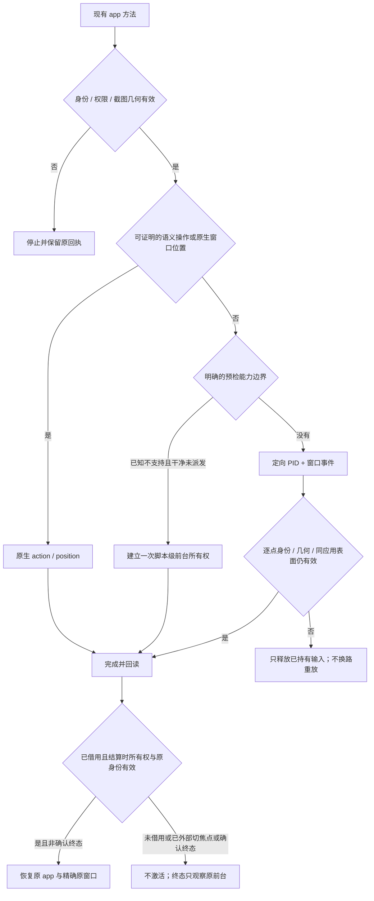

# macOS 输入路由与真实光标

Agent 仍只调用 `apps`、`exec` 和原有 `app` 方法。输入路由是实现细节，脚本不选择
虚拟/物理光标、不维护 Session，也不根据内部投递方式安排重试。正常脚本回执不暴露
`delivery`；私有执行账本保留原始投递证据及派发不确定性。虚拟光标反馈覆盖坐标 click/move/drag/scroll；语义 AXPress、键盘和 AXPosition 不伪造鼠标轨迹。

本实现接续[逐操作历史审查](macos-ax-cursor-audit-2026-11-03.md)。历史失败记录保留，
其“当前产品”描述只对应当时的二进制，不代表下述当前源码合同。

## 分类规则

`auto` 下每次 `exec` 从后台开始。先证明授权应用、进程出生标识、具体窗口及截图几何，
再选择当前动作的投递路线。只有已知不支持的能力，且预检证明干净 `not_dispatched`、
尚无焦点准备或输入副作用，才可为整段脚本借用一次前台。剩余动作都受该前台所有权约束，
但支持的指针动作仍可使用定向事件；前台所有权与真实光标路线不是同一概念。
`background_only` 不借用，所需动作返回 `foreground_required`。

以下为尚未借用时的能力分类：

| 操作 / 已知条件 | 首选实现 | 自动借用条件 |
| --- | --- | --- |
| 有效语义目标 | AX action | 不为未知 AX 状态或菜单准备焦点；语义失败不自动重放成鼠标点击 |
| 证明是标准标题栏且位置可写 | AXPosition | 不因 AX 不可读或位置设置结果不确定而改路重放 |
| 坐标左/右键、单/双击 | 精确 PID + 窗口事件 | 必要的定向事件 ABI 明确不可用且干净未派发时可申请脚本级前台借用 |
| 内容拖拽，包括 AppKit 控件、Chrome 文本拖选 | 精确 PID + 窗口事件，逐点验证 | 同上；Chromium 标签本身不是拖拽借用理由 |
| 锚点或默认中心滚动 | 精确 PID + 窗口 wheel | 同上；不要求 AX children / AX window inventory |
| 已识别 AppKit / Chromium 的原生悬停 | 预检识别跟踪限制，选择物理光标 | 干净未派发时可申请脚本级前台借用；未知框架不套用该例外 |
| Qt / 未识别框架的悬停 | 定向事件 | 未知不等于不支持；不以未知框架、AX 缺失或普通错误授权借用 |
| 键盘 | 定向路径与精确编辑目的地证明 | 已证明的 native modal/sheet、关联进程接收者、必要定向 API 缺失，或 Chromium Command+A/补充平面 Unicode、AppKit Command+W/控制字符文本，可申请前台借用；不是移动光标的理由 |

视觉输入的 AX 豁免仅适用于坐标指针操作。前台键盘回退仍逐次验证精确 AX 窗口及编辑
目的地，应用 PID 仍在前台不能替代该检查；同一应用内焦点离开目标窗口时停止后续按键。

模态状态本身不要求借用光标。真实 `NSApplication.runModal` 中的定向点击、拖拽已有
独立效果证据，因此指针预检不再依赖 AXModal 或语义树。框架分类读取实际 bundle 的
frameworks / AppKit 元数据，不按 Telegram、fixture bundle ID 或应用名称开白名单。

只有两种指针借用原因进入内部审计：`native_hover_tracking`（仅已验收的原生悬停）和
`addressed_event_api_unavailable`。
缺权限、进程变化、几何过期、遮挡、取消、超时、连接失败和任意 provider 错误均不是借用依据。
物理光标与应用前台分别准入：只有上述已知能力与干净预检可发起脚本级前台借用，
普通鼠标错误不授权激活。未知 AX/modal 错误保留原因，不能当作已证明的 modal 能力。
无窗口快捷键仍有独立的应用身份、前台及配对释放条件，不能据此推断存在可借用的窗口锚点。
选择器不会为 `content_unproven` 或菜单自动聚焦；只读语义启用继续不激活应用。
`fallback_allowed:true` 单独不能改路：还必须是精确的已知能力证据、`not_dispatched`、
预检能力错误，且没有 cleanup error。若依据为 `native_keyboard_semantics`，还必须携带已识别的 `capability_detail`：
`chromium_command_a`、`chromium_supplementary_unicode`、`appkit_command_w`、`appkit_multiline_text`；
这四项只限制 `native_keyboard_semantics`，不是全部前台借用条件。
泛化的 `native_keyboard_semantics` 单独不够，实际框架不能从“不是 Chromium”推断为 AppKit。
内部 `foreground_plan` 还必须匹配当前操作及 visual 分类，且无 error、cleanup error、
focus preparation 或 interruption。已准备、已投递或 `unknown` 的输入不换路重放。

## 脚本级前台所有权与归还

resident worker 在首次借用时保留原前台进程出生标识与精确 AX 窗口对象/窗口 ID，
并为目标建立精确逻辑窗口锚点。因此坐标输入虽可不依赖 AX，持久前台借用仍需要该锚点与
原前台证明；缺少这些证明不会退化成仅按 PID 激活。脚本内可以跟随由保留对象 ancestry
证明的 sheet/popup 后代，不能把同 PID 的兄弟窗口当作原任务窗口。

后续每次输入均复核前台所有权和精确目的地。外部切换到其他 app 或兄弟窗口会使 scope
永久失效；即使焦点后来回来，也不重新武装、不再次激活，后续 payload 停止。
脚本结束释放已持有输入，仅在所有权及原身份/窗口仍有效时恢复原 app 实例及精确原窗口；
若原前台确无窗口，则只恢复原 app。外部切焦点或原身份变化时不强制恢复。
正常脚本结算的焦点归还有独立、最多 2 秒的清理预算；恢复失败是 sticky cleanup failure，
关闭后续派发准入，不能当作恢复成功。

只有同 app 的 `quit_app` 得到 confirmed `application_exited`，或 `close_window`
得到 confirmed `window_closed` 且关闭的是锚点窗口，才是终态。保存提示、后代 sheet
关闭、按键关闭效果或未知退出结果不自行建立这个终态。确认终态后的清理仅观察原前台是否
已自然返回；不再激活任何 app，也不会把第三 app 拉到前台。观察不明不能声称恢复成功。

语义 `AXPress` 的 action reply 预算为剩余请求 deadline 与 2 秒的较小值，区别于属性读取
的短超时。进入派发后 AX 错误或超时均保留 `unknown`，不转换成成功、不改成鼠标重投。
正向 AX acknowledgement 只证明派发被接受，不证明界面效果；deadline/cancellation
的不确定性仍由执行层保留。

本节描述当前源码合同。新的脚本级借用、失效及归还证据与剩余限制见
[脚本级前台验收](computer-use-script-scope-2026-11-04.md)；历史鼠标验收不能代替该生命周期验收。

## 一次全独立验收与最终例外

下述 2026-11-03 固定候选仅保留鼠标路线的历史证据；
[统一验收基准](computer-use-benchmark-2026-11-04.md) 也对应其当时的候选，
均不能外推为当前脚本级前台生命周期的 GUI 验收。

先撤掉全部框架鼠标例外，冻结同一个候选，将点击、悬停、内容拖拽、滑块和滚动全部交给
独立输入，再完成整套验收。以真实回调、控件值、DOM trusted 事件/选区为效果依据，
没有把“工具返回成功”当作成功，也没有在失败后切到物理路径掩盖结果。

| 全独立候选 | 检查 | 通过 | 失败 | MCP 调用 / 检测到系统光标位移 |
| --- | --- | --- | --- | --- |
| 四种 AX 故障（count/range、range、children 不可读、windows 不可读） | 43 | 39 | 4，全部为悬停 | 84 / 0 |
| 原生窗口场景、弹层、滑块、多显示器、取消与遮挡中断 | 44 | 42 | 2，全部为悬停 | 81 / 0 |
| 真实 Chrome，临时独占 profile | 3 | 2 | 1，悬停 | 6 / 0 |
| 合计 | 90 | 83 | 7，属于同一操作形状 | 171 / 0 |

通过的项目包括左右/双击、AppKit 滑块、Chrome 文本拖选、跨显示器内容拖拽、模态窗口
输入、遮挡/取消后的配对释放、原生标题栏移动。七个失败不是七种能力限制，均为原生
悬停缺少目标回调或 DOM hover 效果。因此只对这个已确认形状加入预检例外。

悬停借用复用 CUA `41404b6e797d9c44894ae910859db60303801b4a` 的
[`move_cursor_desktop` / `post_pointer_moved`](https://github.com/trycua/cua/blob/41404b6e797d9c44894ae910859db60303801b4a/libs/cua-driver/rust/crates/platform-macos/src/input/mouse.rs)：
Warp 后按其既有配方，间隔 15 ms，用新的 HID-state source 投递两次 mouseMoved。
两次投递是同一预选动作的固定序列，每次都重新验证目标及取消状态，不是失败后重放。
借用过程沿用现有协调、实例和输入 admission，不建立第二套执行器或 Session。

上游 [action support](https://github.com/trycua/cua/blob/41404b6e797d9c44894ae910859db60303801b4a/libs/cua-driver/docs/action-support.md)
的已验收边界继续作为复用依据，不重新枚举每一种原语。其 AppKit 系统拖放会话、部分
WebView/Electron 拖放另有边界；普通文本拖选通过不等于任意 drag-and-drop 均已支持。

最终候选只改变悬停分支，针对受影响行为复验：

| 最终候选复验 | 结果 | 内部路由 |
| --- | --- | --- |
| 四类 AX 故障中的悬停、故障证明和正常退出 | 12/12 | 4 次悬停借用，全部有真实回调 |
| Chrome 悬停、点击、文本拖选 | 3/3 | 仅悬停借用；点击和拖选仍独立 |
| 真实光标审计 | 18 次 MCP 调用，0 个违规 | 5 次借用均为 `native_hover_tracking`；检测到的 2 次位移均在借用区间 |

该历史验收证明的是**当时通用原生事件路径的悬停缺口**，不宣称 macOS 在技术上无法实现独立
悬停。未知框架不因 AX 缺失或一次普通错误进入借用；后续可直接复用上游新增的已验收路径。

上述历史候选在借用悬停后不立即归还光标，以避免撤掉 hover UI；这不代表当前脚本结束会留下目标 app 前台。AppKit 在已建立跟踪的窗口中偶尔接受
定向悬停，但“真实指针处于窗口几何范围内”不能证明跟踪就绪，新建窗口会吞事件，
因此不把该位置推断用作路由规则。

证据根目录：`/private/tmp/dtw-ax-visual-evidence-20261103/`。全独立候选为
`candidate-independent-all/dtw`，对应 `independent-ax-all`、`independent-scene-all`、
`independent-chrome-all`；最终候选为 `candidate-routing-final/dtw`，复验在
`final-hover`、`final-chrome`。每组保留原始 MCP、私有 route、独立应用状态及完整采样。
更早的失败实验保留原目录，不覆盖、不算作最终候选验收。

## 路由与停止边界

定向输入忽略无关应用的物理覆盖，但仍验证目标应用自身的前后层级、alpha、窗口位置和
实际服务进程出生标识；授权身份不因 helper PID 而改变。拖拽每个新点重新验证；取消或
遮挡中断的 up 使用最后一个已获准落点，不能跳到被拒绝的新点。配对释放只属于原来的
owner 和传输路径，即使原窗口已关闭也不能把释放发送给重用 PID 的新进程。

锁顺序仍是协调锁 → 应用实例锁 → Scene 锁。选择借用必须先释放共享协调/实例锁，再取
排他协调锁并重新验证；不会在持有 Scene 锁时升级成物理输入。

## 验证方式

`DTW_INPUT_TRACE=1` 仅向开发诊断 stderr 写入原生 route / reason / worker PID / window，不更改
Agent 工具 schema。`cursor_audit.py --assert-independent` 在每个原始 MCP request ID 的
完整区间采样真实系统光标，并逐条核对路由；终点归位不算独立，未知借用原因直接失败。
取消但无回复的请求保持无回执状态，清理区间截至下一次成功读回。

真实光标审计策略为 `bounded-pointer-borrow-v3`，其逐操作区间只审计指针借用，不证明脚本级前台所有权或归还。私有 `dtw_input_interval` 以 worker PID 与 trace ID
配对每次指针借用的 begin/end，覆盖准备、派发及收尾，并在释放物理输入 lease 前结束。
只有 `native_hover_tracking` 的 move，或 `addressed_event_api_unavailable` 的指针动作可进入允许区间。
混合脚本中的每次采样位移都必须完整落在一个允许区间内；一次合法 hover 不放行整段脚本。
旧的单点借用日志不能单独通过新策略；缺失/不配对日志、采样不可用、未覆盖完整请求及只读期间
的未获准位移都会使严格验收失败。严格策略的实际最大采样间隙固定为 50ms，任何超过阈值的
间隙均失败，不能将长时间停采后的相同终点当作连续稳定；报告保留未四舍五入的实际间隙。常见的 AXPress 语义点击按其精确 native action 证据核对。

每条借用记录必须同时检查独立应用效果。采样默认 2 ms，报告实际最大间隔；比间隔更短的
位移不能排除，位置变化本身也不能证明由 DTW 导致。原始失败、MCP 帧、stderr、fixture
状态及采样数据保存在同一证据目录，避免重跑后覆盖。

统一 [Computer Use APP](../tests/fixtures/computer-use-app/README.md) 的标准入口强制执行该策略，
并单独捕获经过身份验证的虚拟光标 helper 窗口，核对实际热点坐标和渲染像素。

自建 AppKit、真实 Chrome 的临时 profile、源码/纯控制测试分别记账。这些不是模型 Harness
A/B、真实账号验收或所有应用完备性证明。历史记录中的 Windows 源码/测试类型检查
也不是 Windows GUI 验收，不能用 macOS 结果代替。本轮 macOS 定向验收的候选身份、
业务效果、连续焦点、严格光标及清理结果分别记账；未运行 Windows GUI 验收。
