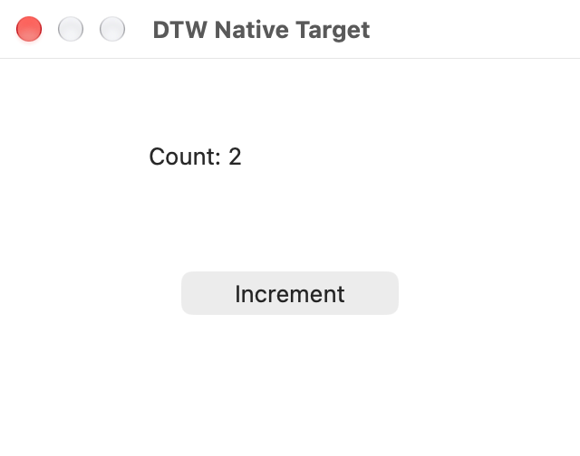
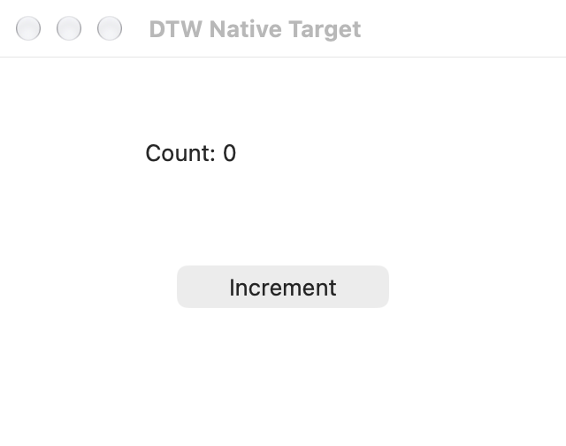

# 多应用执行与资源骨架验收

日期：2026-10-28。基于已合并 #61（`f818d4b7192bd42db85c6af0a73168ee64088979`），实施源码提交 `db24070966e2096676c2d787331661aaa6d9bada`。记录本次验收的 `fd059c0` 仅增加文档与证据。后续 app/source 接口修订及新二进制、Claude 验收单独记录于[接口验收](app-source-acceptance.md)，不替换下列历史结果。

本轮目标是修正多应用、多会话和原生资源的基础关系，并明确后续能力合同。没有批量迁入新动作，也没有宣称后台、鼠标独立或锁屏路线已经实现。设计与顺序见[架构基线](next-architecture-baseline.md)。

## 实现范围

- 会话保留各 app 的逻辑上下文；A→B→A 保留已提交 JSON state 和窗口引用。取消/超时或原生 owner 重建保留已提交 state，原生 refs 需重新发现；真实 app 实例替换才清空 state，并通过 `state_reset` 区分。
- 每个 app 保留 AX worker；截图/坐标点击使用由 MCP 进程直接拥有的短命 scene child，停止并 reap 后才释放 scene lease。闲置 app 不长期占锁，返回 app 无需为此重建上下文。
- 默认执行期限 30 秒，可由调用方调大或调小；省略 `max_calls` 不设置次数配额。取消原先每 64 次请求更换 owner 的行为。保留 VM、回执字节与会话容量保护，完整保留跨阈值的最后一条动作证据。
- scene 和 resident worker 的持久清理失败独立传播到 Job/脚本/会话；不能被 JS catch 绕过并提交 state，也不能通过切 app 继续派发。原 native outcome、unknown、首个清理错误和原始请求回执分别保留。

## 本地自动验证

该次二进制位于 `/private/tmp/dtw-standard-agent-target/debug/dtw`（路径会被后续构建覆盖），SHA-256：

```text
693e94f82e34227e9e023c6b2fb2cbc5dc6f85919a00777dd7fccbe4885ffa69
```

| 验证 | 结果与范围 |
| --- | --- |
| Cargo `--all-targets --locked --offline` | 182 项库测试、4 项 CLI 测试通过；库测试 5.11 秒 |
| `scripts/check-source.sh` | 版本/格式、41 项独立 Core、20 项 IPC、12 项 Python 负控通过 |
| Swift 库存与输入控制 | 100 + 14 条断言通过，无 GUI 访问 |
| 两类实际 native worker 生命周期 | 共 8 项 TERM、EOF、畸形输入、父进程死亡检查通过；无 AX/SCK/输入操作 |
| 资源边界 | 超过 5 秒与 32 次调用；第 65 次后保留窗口引用；第 513 个请求拒绝且原回执可读；回执跨阈值保留最后一条 unknown action；清理失败不可被 catch 或切 app 绕过 |

CI 配置未增加作业、未恢复 CUA 构建；两项远端轻量检查仅证明其实际覆盖范围，不能替代这里的本地协议和 GUI 证据。

## 真实 GUI 与普通 MCP

环境：macOS 27.0.1（26A434），arm64，现有开发权限。使用自有 AppKit fixture，通过普通 `dtw mcp` stdio 交互，无专用 Host 或 grant。命令：

```sh
python3 tests/acceptance/standard_agent_probe.py \
  --dtw /private/tmp/dtw-standard-agent-target/debug/dtw \
  --output /private/tmp/dtw-multi-app-gui-20261028 --pixel-click
```

本次单次验收通过，总时长 9.35 秒（含 fixture 准备及清理）。完整本地记录：`/private/tmp/dtw-multi-app-gui-20261028/evidence.json` 与两份 `mcp.jsonl`。仓库保留[脱敏摘要](evidence/multi-app-20261028/summary.json)及仅含测试窗口的截图，未收录运行中真实应用清单。

| 场景 | 实际结果 |
| --- | --- |
| 语义 press → 独立读回 | target 计数 0→1，peer 不变；原请求回执保持一致 |
| 截图 → 坐标 click → 独立读回 | target 计数 1→2；图像坐标 `(320,324)`；无重复动作 |
| 标准 MCP 取消 | 未提交修改丢弃，取消前已提交 state 保留；新原生 owner 报 `context_reset=true`、`state_reset=false` |
| A→B→A | 各 app 的 state 保留；第三次直接使用 A 保存的 window_ref，无重复列窗；全部 `context_reset=false`、`state_reset=false` |
| 两个独立 MCP 会话 | 同 app 的 JSON state 不串；不同 app 的三轮同时请求截图共 6 张成功；scene 临界区仍串行 |
| 关闭其中一个会话 | 另一个会话继续用原 window_ref 截图成功 |
| 错误与清理 | 旧引用、跨 app 引用和不存在 app 的拒绝保持；计数器未意外变化；两个 MCP 进程、其 worker 和两个 fixture 全部正常退出，无强制信号 |

A→B→A 的三次 `exec` 分别执行 2、2、1 次脚本方法调用，往返 275、359、267 ms，共 901 ms。双会话同时请求截图的单次往返为 270–412 ms。这些是固定自有窗口的工具耗时，不包含模型思考，也不是广泛应用性能基准。

截图人工检查显示 A 为 Count 2，B 为 Count 0；所有图片尺寸为 640×504：




## 尚未覆盖

当前同一 MCP 连接仍串行执行脚本；不同连接隔离不等同于同 app 跨会话写入仲裁已经完成。现有 scene 锁仅管理已接入路径，不是完整键鼠资源调度器。

基础窗口截图/点击仍依赖 AX 归属和模态校验。WindowSurface 与 SemanticBinding 解耦、真正的原生 frontier 分页、类型/关键字/区域筛选，以及默认简洁结果投影和按需完整诊断，本轮只明确合同，尚未实现。当前 exec/result 仍返回步骤账本。

本轮没有测试后台新路线、鼠标独立、锁屏、Windows、Browser/DOM 或发行包。agy/Claude Code 的模型工作流沿用 [#61 的历史结果](standard-agent-acceptance.md)，未以新二进制重跑模型验收。真实 TextEdit 闭窗/Space 证据仍见 [C5 报告](c5-completion-acceptance.md)，本轮 fixture 验收不扩大其结论。
