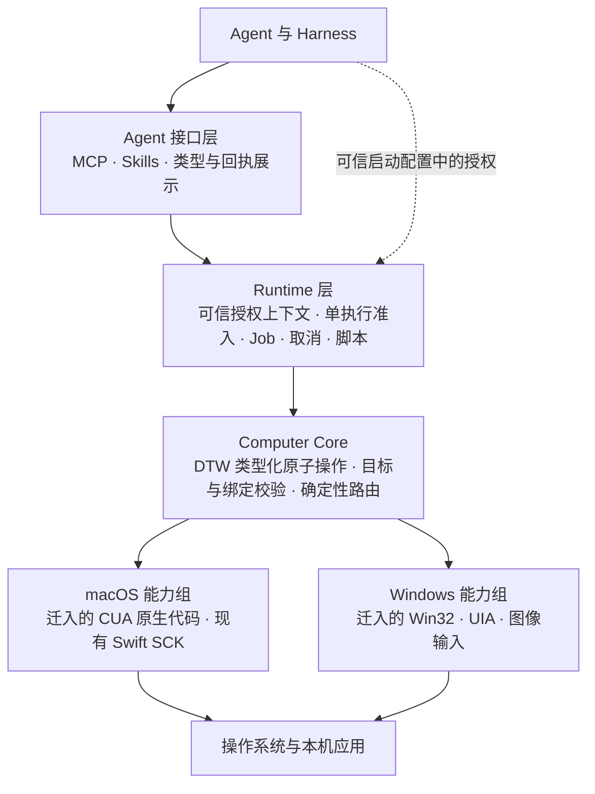

# DTW 下一阶段架构基线

状态：方向已确认；#59 合并后的单一重写版已完成 C5 核心与 macOS 五方法验收，不再追加 C5 细分检查点。C6 可沿现有合同批量扩展选定能力组与 Windows 原生。日期：2026 年 10 月 28 日。证据见 [C5 完整验收](c5-completion-acceptance.md)，准入见 [实施检查点](implementation-checkpoints.md)。

发布方向已更新：下一次 release 只交付重写后的可用版本，旧兼容路径彻底退出，不保留旧 facade、CUA worker 或双运行模式作为发行内容。早期先完成可验证的功能切片和[产品矩阵](product-matrix.md)，再按实际需要为稳定的核心行为增加 CI。日常 CI 不再构建或回归旧发行包。

DTW 的目标是拥有独立的 Computer Use 能力模型、执行语义和演进权。底层尽量复用 CUA 的成熟代码，按有明确状态边界的能力组迁入；平台差异留在适配器内。Agent 面对少量 MCP 方法、Skills 和按应用操作的脚本入口。

实施采用“确定内核契约 → 可运行骨架 → 少量核心能力迁移 → 稳定外部协议 → app 脚本 → 批量扩展”的顺序。目标身份、授权、绑定与动作结果语义必须先确定。当前 C1 已建立 DTW 自有类型与执行内核；C2/C3-macOS 通过受监管的 DTW 原生 worker 完成 discovery、SCK capture/click、窄范围 AX snapshot/AXPress 的真实闭环；C4/C5 已接入单 app 协议、Harness 和有界脚本。代码来源、窗口覆盖、取消后的迟到效果及验证边界见各检查点证据。重写版已是唯一默认构建与 `dtw app` 入口；旧默认入口、CUA SDK/worker 依赖、legacy feature 和旧打包链已在 #59 删除。

## 源码基线与研究取舍

| 基线 | 固定内容 | 用途 |
| --- | --- | --- |
| DTW 历史行为 | `a1833a1fbc80de6e14fc86a0972782a00706de33`，已合并 #52 | 场景参考与功能来源，不要求兼容旧实现 |
| CUA 首批来源 | Driver 0.38.0，`85e2b1318bd77ccf3cfa88ccdf875a4bb7eaed19` | 可追溯的代码来源，不随新版分发完整上游 worker |
| 长期架构 | 本文中的分层、身份、授权、绑定、效果与生命周期规则 | 约束后续实现与替换 |

本方案采用按能力组复用、DTW 统一执行边界和脚本 Host Call 解耦，并确定三项迁移取舍：

- 不把整个 CUA Vendor 作为前置工作。只有需要修复耦合较深的特定能力组时，才保留带来源的固定源码快照。
- 首批必须完成少量真实源码迁移，证明独立维护路径可行；仅把 `call_tool(name,json)` 包装成新接口不算迁移完成。未迁入的复杂组明确未实现，按产品矩阵逐组补齐。
- 接受早期项目的有意破坏性改造。保留用户可观察的正确行为和验收场景，不强制永久兼容 CUA 的对象名、全部方法或内部结构。

上游 main 已继续变化，2026 年 10 月 27 日架构调研时的快照为 `92706b2a01c0558a5ec34cee55aa4995cb76fb05`；它不进入首批基线。0.38.0 的 GitHub release 标为 prerelease，本文将其称为已采用的组件版本，不将其等同于正式稳定版认证。长期稳定指不变量和版本化契约，不指依赖、目录或实现永远不变。

## 历史耦合与已实施约束

| 重写前事实（历史基线） | 已实施的新架构约束 |
| --- | --- |
| 脚本整体交给 CUA `run_script`，内部原子调用绕过 DTW 分派 | 新 app 脚本必须由 DTW 持有 Host Call 入口 |
| CUA 实际执行资源授权和 grant expiry，DTW discovery 主要展示范围 | 新能力必须在 DTW 内完整执行授权，不可只复制 manifest 展示 |
| SCK `app/click` 在 bounded 模式禁用 | 接入新内核前要实现同等目标和资源约束，不能直接解禁 |
| CUA token 与 DTW 截图绑定属于不同状态域 | 统一引用外壳及准入规则，保留原生 handle 的后端归属 |
| CUA `ToolResult`、错误、图片类型穿透 DTW 多层 | 核心数据类型由 DTW 定义，转换限制在边界 |
| 每个 Runtime 同时只接纳一个执行，忙时返回 `runtime_busy` | 首版保留此行为，不误称已有 FIFO 队列，也不提前增加调度系统 |

以下链接固定在重写前提交，仅用于追溯问题来源；不描述当前代码。历史事实入口见 [脚本分派](https://github.com/caelis-labs/desktop-world/blob/a1833a1fbc80de6e14fc86a0972782a00706de33/cmd/dtw/src/main.rs#L1362)、[授权权威](https://github.com/caelis-labs/desktop-world/blob/a1833a1fbc80de6e14fc86a0972782a00706de33/cmd/dtw/src/authorization.rs#L143)、[SCK 限制](https://github.com/caelis-labs/desktop-world/blob/a1833a1fbc80de6e14fc86a0972782a00706de33/cmd/dtw/src/main.rs#L742)、[执行准入](https://github.com/caelis-labs/desktop-world/blob/a1833a1fbc80de6e14fc86a0972782a00706de33/cmd/dtw/src/main.rs#L1063)。

## 分层与职责



图示调用方向，不要求每个方框独立进程或独立 crate。

| 层 | 拥有的职责 | 不向该层上方泄漏的细节 |
| --- | --- | --- |
| Agent 接口 | MCP 入参、发现、版本协商、结果分页、Skills | CUA 原生 schema、provider 名称和 native token |
| Runtime | 上下文、可信 grant、准入、Job、脚本预算、取消、回执与 JSON state | OS 句柄、COM、AX 遍历、截图实现 |
| Computer Core | 类型化操作、身份与引用规则、派发前校验、能力路由、效果模型 | CUA ToolRegistry、SDK Session、Manifest 类型 |
| 平台能力组 | OS 操作、原生对象保活、原生证据、平台线程与资源清理 | 平台细节只通过 DTW 定义的结果和附加诊断返回 |

Harness 决定是否授权；DTW 持有并执行该授权。每个执行上下文只有一份权威 grant 和一份引用注册表，由 Runtime 管理生命周期、Computer Core 负责准入与失效规则。Provider 内可以保存 AX/COM 对象和原生引用，但不能自行创建用户授权或延长 grant。

先保留一个 Cargo package，在 `agent/`、`runtime/`、`computer/`、`backends/` 中形成清晰模块边界。组合入口负责构造具体后端，Core 只依赖自己的类型与能力接口；边界检查防止上层重新导入 CUA 类型。独立 crate 在需要编译隔离或独立复用时再拆，不以目录数量衡量架构完成度。继续使用 Rust；保留已有 Swift 桥和可终止私有子进程，阻塞的原生操作不并入 MCP 主进程。

## 必须长期保持的内部契约

| 概念 | 约束 |
| --- | --- |
| `AppIdentity` | 应用身份与展示名称分开。平台证明可用 bundle、规范化安装位置、签名或包信息等证据组合；不能只凭名称匹配授权 |
| `AppInstance` | 运行实例带进程出生代际；PID 复用、重启使旧实例引用失效 |
| `WindowRef` | 绑定实例及可核验归属。窗口号、标题、尺寸、z-order 单独都不是授权依据 |
| `ExecutionContext` | Harness 可信通道授予 app、能力及附加资源范围；Agent 请求只选择目标，不能自证已授权 |
| `ObservationRef` | 绑定 context、app 实例、window、provider、kind、generation 和有效期；图片还含尺寸、坐标系与变换证据 |
| `Capability` | 明确 supported、unsupported 或受条件限制；表示后端能做什么，与 grant 允许做什么分别判断 |
| `ActionOutcome` | 派发状态与效果证据分开；原始诊断可追溯，不能被 compact 输出改写为成功 |

动作结果至少区分 `not_dispatched / dispatched / unknown`，效果证据区分 `confirmed / unverified / mismatch`。`confirmed` 只针对明确后置条件，Job completed 不代表业务任务完成。取消或超时后的效果不明必须保留 unknown，不能换后端自动重发。脚本 JSON state 可以只在成功时提交，真实桌面的点击、保存和输入不具备事务回滚。

绑定按来源路由动作：AX snapshot 与语义动作成组；截图、几何变换与像素动作成组；浏览器 profile/target/frame/ref 与 DOM 动作成组。一个观察结果可携带不同来源的证据，但它们不是原子快照；各自的代际和有效性必须保留，不能拼出一个假定同时有效的通用 token。

只读重观测可以有明确预算。改变 provider 需要重新观察并生成新引用；已有动作失败、已派发或结果未知均不触发自动 fallback。声明的资源覆盖必须真实：只覆盖可见普通窗口时，不伪装成全部窗口或自动选择“主窗口”。

同一 Runtime 首版仍单执行准入；脚本解释器、原生 worker 和子进程有明确关闭顺序。GUI 施工与验收按物理桌面串行，现有 SCK lease 不被当作所有 CUA 输入的全桌面锁。多 Runtime 的输入仲裁暂由 Harness 协调。

## App 级脚本和 Harness 授权

V1 每次脚本执行绑定一个 app。应用发现是独立的低权限 catalog 操作：能列出应用，不代表能读取其 AX、截图或操作。Harness 审批可以展示应用身份、当前实例以及 observe、semantic input、pixel input、launch 等能力；实际 grant 由可信配置提供，不能由模型填写 `approved:true`。

概念上的调用形态如下，字段名和脚本 API 尚不冻结：

```text
exec(app_ref = 已发现的应用引用, script = ...)
    Harness 批准该 app 和所需能力
    Runtime 注入已绑定的 app 对象
    每次 host call → DTW core 校验 grant、实例、window 和 binding
```

脚本可以从 `app.windows()` 枚举其范围内窗口、按明确条件选取，再观察、操作和验证；同名多窗口仍需消歧。脚本内不提供任意 PID 的 `getApp`、全局 `launch` 或任意 `call(tool,json)` 逃逸口。跨 app 流程先由 Harness 串联多次执行；系统 picker 和 helper 只有在归属证据及授权范围都满足时才属于该 app。

静态解析可用于语法检查、诊断和向 Harness 展示意图，不能代替逐次 Host Call 的授权。采用现成 QuickJS/rquickjs 引擎及可复用封装，不自造 JS parser；Host Call 进入 DTW Core，禁止任意文件、网络、进程访问，并限制时间、内存、栈和原生调用次数。

允许某个浏览器 app 不自动授予所有个人 profile、origin 或文件传输；这些是附加资源约束。剪贴板、桌面级截图等共享资源也不能从 app scope 隐式取得。App 级授权约束的是 DTW 的目标和能力，不声称限制应用自身的一切外部副作用，例如浏览器页面提交或应用内发送消息仍需 Harness 的任务政策。

首版 grant 可在启动时冻结，变更通过新上下文生效；预留版本化演进，不先建设动态审批 broker。旧 unrestricted CUA 脚本和旧运行模式退出下一发行版本；新 app 授权入口没有旧路径 fallback。

## CUA 源码迁移单位

| 能力组 | 首批处理 | 必须一起处理的依赖 |
| --- | --- | --- |
| 应用和窗口发现 | 优先窄源码迁入；macOS 运行应用及窗口，Windows 进程和 HWND 基础枚举 | 身份证明、覆盖范围、错误；按实际函数闭包裁剪 |
| 精确截图与像素点击 | 整合现有 DTW SCK 组，继续保留已验证行为 | 图像坐标、目标身份、遮挡、一次性消费、输入与超时结果 |
| AX 观察与语义动作 | 第二个迁移切片只做 snapshot 与一种 press/invoke，后续再加 setValue | 精确窗口再验证、retained AX/COM 对象、token store、代际、原生线程、调用期限和清理 |
| Windows UIA 与截图 | 先证实已有路径和失败机制，再迁入必要组 | COM apartment、single-flight、provider 阻塞、WGC/DPI、效果证据 |
| 键盘、文本、滚动、拖拽、菜单、focus | 在最小闭环和协议成立后逐组扩展 | 目标、焦点/路由、修饰键释放、平台副作用 |
| Browser CDP | 后置；从固定来源按需迁入，并重新验证资源限制 | profile/endpoint、session、tab/frame/ref、origin、文件授权和清理 |
| QuickJS | 原子闭环之后移植引擎封装与必要 facade | host channel、限额、源码定位、取消；不复制整套 CUA registry 调度 |
| Cursor、录制、Perception、VM、Spaces、Cloud | 不在首批范围 | 由实际 DTW 需求重新决定，不随源码目录带入 |

两处源码事实影响迁移预算。macOS 的窗口枚举包含 [SkyLight SpaceQuery](https://github.com/trycua/cua/blob/85e2b1318bd77ccf3cfa88ccdf875a4bb7eaed19/libs/cua-driver/rust/crates/platform-macos/src/windows.rs#L187) 及 AX 路径，不能整文件复制后称为纯公共 API。首批优先采用公共 API 子集并声明覆盖差异，未必要的私有 Space/后台输入路径不带入。

AX 精确窗口关联另有私有 `_AXUIElementGetWindow` 依赖，见 [exact_target.rs](https://github.com/trycua/cua/blob/85e2b1318bd77ccf3cfa88ccdf875a4bb7eaed19/libs/cua-driver/rust/crates/platform-macos/src/ax/exact_target.rs#L5)。它与 discovery 的 SkyLight 裁剪分别决策。B2b 先验证映射方案：优先公共证据；若需保留私有调用，将其隔离在有明确能力声明的 provider 内，否则缩小支持范围。不能用标题或尺寸猜测替代精确归属。首版 press 仅支持明确 advertised 且实测的 AXPress 控件，派发前校验 element 到 exact window、持有原生 guard、执行 mutation admission，并处理原生调用期限和未知效果；菜单、selection/pixel fallback、自动 focus assist 和 setValue 后置。

CUA 0.38.0 已[调用 WGC](https://github.com/trycua/cua/blob/85e2b1318bd77ccf3cfa88ccdf875a4bb7eaed19/libs/cua-driver/rust/crates/platform-windows/src/capture.rs#L369)，不按“缺少 WGC 实现”安排重写。Windows 主要门槛是图像与 DPI 几何一致、输入后验证及阻塞治理。[#36](https://github.com/caelis-labs/desktop-world/issues/36) 的历史失败需要在迁移基线上重新实机验证；旧版本失败不是新版本现状的充分证明。

[QuickJS 引擎](https://github.com/trycua/cua/blob/85e2b1318bd77ccf3cfa88ccdf875a4bb7eaed19/libs/cua-driver/rust/crates/cua-driver-core/src/script_tool/engine.rs#L1)已有单一 host channel 和预算模型；其隔离边界可复用，具体 Host Call 和业务编排归 DTW。

每组记录 source commit、原始路径/hash、目标路径、依赖闭包、版权及派生 notices、机械改动与行为补丁、测试和平台证据。沿用 [第三方来源记录](../THIRD_PARTY_NOTICES.md)，但根据迁入代码的实际组成更新。上游更新按选定 diff 和能力组评估，不滚动追 main；同一组不长期维护两份可自动互相 fallback 的 fork/port 实现。

## 阶段与退出门槛

| 阶段 | 交付 | 退出门槛 |
| --- | --- | --- |
| B0 / C0 方向确认 | 架构、内部不变量、来源基线、app 脚本方向、首批范围 | 能明确推导同名应用、越权、重启、旧引用、超时与取消结果；已确认实施方向 |
| B1a / C1 独立执行内核 | DTW 类型、可信 context、单执行准入、binding store、静态能力组合和测试后端 | std-only 内核可独立用 rustc 编译；测试后端完成 observe → press → reobserve；错误目标、授权、引用在派发前拒绝，取消与效果语义可执行验证 |
| B1b / C2 原生进程边界 | 将内核接入真实平台能力，落实 worker 启停、取消、超时、退出与资源清理 | 按平台验证停止接收、终止与回收；派发后未知不重放；不能用 C1 的测试后端代替原生阻塞和进程终止证据 |
| B2a / C2 首批源码迁移 | 小范围 discovery/身份核验，接入现有 SCK 成组能力 | discovery 不再依赖 CUA worker；多实例/隐藏/关闭/部分覆盖真实；macOS SCK 通过统一授权与原有 GUI 回归；Windows 基础只读证据单列 |
| B2b / C3 最小语义闭环 | AX snapshot + 一种 press/invoke；与像素能力共同接入 | app scope → exact window → observe → 一次动作 → 独立读回；引用/代际/取消/对象保活测试成立；macOS 与 Windows 分别验收 |
| B3 / C4 稳定外部协议 | 基于闭环确定版本、能力声明、request/receipt/errors/cancel/result | Harness 能在派发前明确审批 app 和能力；平台原生 schema 不成为公共契约 |
| B4 / C5 App 脚本 | QuickJS facade 和全部经过 Core 的 host calls | 同一 app 脚本组合语义和像素能力；无法越权或进入旧 unrestricted 路径；脚本错误不抹去已发生效果 |
| B5 / C6 批量扩展 | 键盘/文本/菜单/焦点/滚动/拖拽、Browser、Windows 深层能力逐组迁入 | 每组来源、契约、真实平台验收及旧路径清理完成；仅扩展 DTW 选定范围 |

B1/B2 通过内部测试入口验证，不先发明临时公共 DSL。B1 的完成需要 B1a 与目标平台的 B1b 都通过；C1 不承担真实平台或子进程终止验收。B2b 若 AX 源码闭包尚未验证，该能力保留未完成，不能用旧 CUA backend 充当新版交付。每次只推进当前检查点，完成实现、针对性验证、差异审阅和证据记录后，再按 [检查点准入规则](implementation-checkpoints.md) 推进下一步。

新架构与已发布版本有明确版本边界，不提供旧脚本 facade 兼容。未完成的能力明确 unavailable；下一 release 以产品矩阵中选定并实测的新版工作流为准，不要求复刻全部旧能力。已有 tag 和已发布资产保留为历史版本。

## 验收与并行施工方式

先复用已有协议、授权、生命周期、场景和 #49 GUI 用例，补充新边界的有效测试。每个动作组必须包含成功效果的独立读回，以及派发前拒绝、派发后未知两类失败。测试替身证明分派规则；真实 macOS/Windows 证明原生行为；最终分发包再验证安装后的 TCC、runtime 依赖和子进程身份。三类证据分别记录。

macOS 首个垂直切片必须涵盖多窗口/浮层、隐藏窗口、AX 延迟、移动后的旧截图、遮挡、取消不重放及至少一个真实应用流程。Windows 基础只读组可并行推进，但 UIA/WGC 动作组的承诺以实机为门槛，覆盖 DPI-unaware、100%/125% 与混合 DPI、modal picker、阻塞后取消/重启和迟到输入。没有 Windows 实机证据时保留受限支持，不用交叉编译或 CI 替代。

子代理适合在接口收敛后分别负责 discovery、完整 AX 组、完整像素组、来源记录和测试迁入。统一设计者先拥有 `Target/Grant/Binding/Outcome` 与生命周期规则；同一个 AX snapshot/action 或 capture/click 状态组由同一个施工责任人完成。机械搬运、类型适配、行为修复分成可独立审查的提交，GUI 验收串行，保留其他工作区与原始失败证据。

不沿用调研中的人周和“复用 80%”作为承诺。先记录 B2 两个真实切片的依赖、修改量、问题和验收耗时，再估后续批量范围。应用身份跨平台证明、系统模态归属、UIA 强制终止后的迟到效果是早期专项验证项；尚不能确定的语义采取拒绝或 unknown，不以 fallback 掩盖。

## 已确认的实施方向

1. DTW 自有 Computer Core 和执行语义，CUA 是代码来源及可替换实现。
2. Rust 单包模块分层起步，保留 Swift 和原生进程隔离，先不建设动态插件或共享 daemon。
3. 先固定身份、授权、绑定、效果不变量，再迁入少量核心能力；外部协议和脚本工程随后推进。
4. 脚本从第一版就按单 app 设计，Harness 审批，Host Call 逐次强制执行范围。
5. 以明确状态边界成组迁移，首批 discovery、现有 SCK、最小 AX 动作为验证切片；Browser 与批量能力后置。
6. 长期稳定的是契约和边界，具体源码版本、provider 实现与模块划分允许受控演进。
7. 下一 release 仅包含重写路径；先快速验证功能和产品矩阵，再为需要长期保护的核心行为按需增加 CI。
