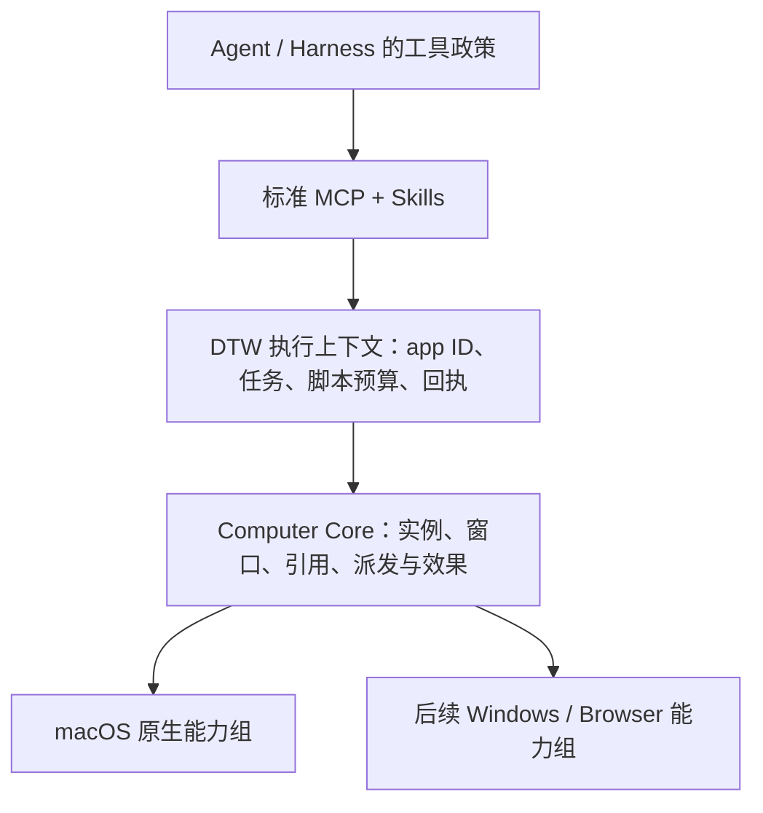

# DTW 架构与演进基线

日期：2026-10-28。#61（`f818d4b7192bd42db85c6af0a73168ee64088979`）完成标准 Agent 接入；本轮进一步明确多应用、多会话和基础/高级能力的演进基线。**DTW 不管理审批和授权。执行只要求平台稳定 app ID 字符串，供 Harness 直接解析；全部交互使用标准 Agent 扩展点。** 这一决定替代 C4/C5 中要求 Host 创建 grant、提供回调或管理授权上下文的设计。

下一 release 只交付重写版。旧 CUA SDK/worker、旧 facade 和旧打包链不恢复。先完成可验证工作流和[产品矩阵](product-matrix.md)，再按实际需要保护稳定行为；日常 CI 保持轻量。

## 固定的方向与可演进的接口

DTW 拥有独立的 Computer Use 类型、执行语义和演进权。CUA 是按能力组选择的源码来源。长期稳定的是应用身份、引用归属、派发与效果语义、资源所有权和生命周期；方法集合、观察字段与平台支持随经过验证的工作流演进。

| 基线 | 固定内容 | 用途 |
| --- | --- | --- |
| 原生与脚本历史证据 | #60，`d0d8279130b74a58496e13b7f6a4c4565f6f00cf` | C5 历史行为和验收记录，不要求兼容旧 Host-grant 接线 |
| CUA 源码来源 | Driver 0.38.0，`85e2b1318bd77ccf3cfa88ccdf875a4bb7eaed19` | 按映射职责迁入，不随 DTW 分发完整 CUA worker |
| 当前接入 | `dtw mcp`，标准 `apps / exec / result` 与 Agent Skills | 普通 Agent 配置即可接入，无 DTW 专用 Host 适配要求 |

## 分层与所有权



| 层 | 职责 | 不属于该层的职责 |
| --- | --- | --- |
| Harness | 工具审批、任务政策、不同工具间的调度 | 不需要实现 DTW grant、回调或续租协议 |
| Agent 接口 | 标准 MCP、app ID、脚本描述、结果/图像、Skill | 不把平台原生 schema 或 token 当公共 API |
| 执行上下文 | 单执行准入、Job、VM、JSON state、预算、取消、回执和清理 | 不作授权决定，不创建授权状态机 |
| Computer Core | 类型化操作、身份/引用校验、能力路由、效果模型 | 不导入 CUA ToolRegistry、SDK Session 或 Manifest |
| 平台能力组 | OS 操作、对象保活、原生证据、线程与资源清理 | 不决定工具审批、不将失败自动切换为另一输入路线 |

一个 MCP 会话持有多个逻辑 App 上下文；每个 App 上下文绑定自己的运行实例、已提交 JSON state 和引用生命周期。一次 exec 仍显式指定一个 app，便于 Harness 解析普通参数；这不限制整个 Agent 会话只能操作一个应用。Provider 可以保存 AX/COM 对象以及原生 token，不能自行把目标换成另一个应用。继续使用一个 Cargo package、Rust 内核和已有 Swift 桥；阻塞原生操作留在可终止的私有子进程内。模块边界由依赖与责任体现，不用 crate 数量衡量架构完成度。

## 稳定 app ID 与内部实例绑定

`apps` 返回去重条目 `{app: "com.apple.TextEdit", name: "TextEdit"}`。每次 `exec` 必须提供 `app` 字符串，结果原样回显。macOS 使用 bundle ID；其他平台的稳定标识由对应 provider 明确定义。展示名称不能替代它。

app ID 是目标身份，不是权限 token。DTW 不要求、接收或验证用户审批事实。Harness 直接解析普通 MCP 参数中的 app 字符串；未实现细粒度策略的 Agent 也能正常调用工具。PID、进程出生代际、路径证明和其他内部身份结构不进入模型参数。

```text
apps() -> [{app: 稳定平台 ID, name: 展示名称}] + 方法/schema/限制
exec(app = 稳定平台 ID, source)
    -> 内部分配执行标识，解析唯一可操作运行实例
    -> 注入只绑定该实例的 app 对象
    -> 每次原生调用校验实例、窗口、provider 与 observation
    -> 等待执行收尾，回显 app ID、结果、步骤/动作摘要与图像
result(app = 原 app ID, execution_id = 可选历史引用)
    -> 默认读取该 app 最近接受执行的完整原始账本；指定引用时读取历史记录
    -> 不执行、不解析新实例替代原回执
```

模型只需要指定 app 和脚本；执行编号、传输去重、取消关联和回执归档由 DTW/标准传输内部管理。正常工作流不需要生成 ID 或提交后轮询；历史查询才按需使用返回引用。不同的新调用不按脚本内容去重。

没有隐式默认 app。普通 Chrome helper 不作为独立可操作应用；执行时同一 ID 对应多个独立实例则返回 `ambiguous_app`，不按名称、前台状态或 PID 猜选。应用重启不改变稳定 app ID，但会使旧实例引用失效；state 和观察不能移植到另一个进程。实例绑定是 DTW 内部执行正确性要求，不增加外部参数。

| 概念 | 必须保持的约束 |
| --- | --- |
| `WindowRef` | 绑定应用实例和可核验窗口归属；标题、尺寸或 z-order 只能辅助选择 |
| `ObservationRef` | 绑定 context、app、window、provider、kind、generation 和有效期；像素观察包含尺寸与坐标变换 |
| `Capability` | 描述后端支持和原生执行条件，不表示用户授权 |
| `ActionOutcome` | 分开报告派发状态和效果证据，保留结构化原生错误 |
| 执行期限 | 约束本次操作和脚本的资源占用；不是审批到期或授权续租 |

派发状态为 `not_dispatched / dispatched / unknown`；效果证据为 `confirmed / unverified / mismatch`。`confirmed` 只针对具体后置条件。完成执行不等于完成业务任务。脚本 JSON state 只在成功时提交；已经发生的点击、保存和输入不能回滚。取消、超时或未知效果不触发自动重放。

## 脚本内容、文件输入与远程执行

公共执行合同保持内容输入 `exec({app, source})`，不要求 Agent 和执行机共享文件系统。JSON 字符串由调用程序序列化、服务端解码一次，之后原文进入 JS 引擎；不重复 unescape、猜测修复反斜杠或经过 shell 展开。模型直接构造参数仍可能把正则 `\b` 写成 JSON 退格转义：合法 JSON 不保证表达了原本意图，运行时不能可靠推断或修复。

文件输入保留为可选的客户端/CLI 便利能力：读取调用方文件并固定本次内容，再序列化为同一 `source` 请求发送。文件路径不进入远端执行合同，模型无需计算 Base64、哈希或上传编号；普通 MCP 客户端不依赖这个便利层。文件来源和内容摘要可在客户端内部记录，报错映射回原文件。当前尚未实现该便利入口，标准 MCP 也不会自动读取传入的本地路径。短脚本继续直接提交内容，文件方式用于长脚本和复用流程。

远程机器通过配置的 MCP 服务端选择；`app` 在该服务端对应的机器内识别应用，不把机器地址塞进 app ID。脚本在远端 DTW 执行，截图与结果沿消息返回。目标机器需有 DTW、可用桌面会话和相应系统能力。网络连接的身份校验属于标准传输/部署，动作审批仍属于 Harness。

首版只做好本地 stdio，远程传输不构成首版阻塞项。协议层明确优先复用 [MCP 官方 Rust SDK rmcp](https://github.com/modelcontextprotocol/rust-sdk#transports)：它提供 stdio、Streamable HTTP 和进程内 transport，按 Cargo feature 选择；不为未来形态预先启用 HTTP、认证或服务部署。当前已迁入并锁定 `rmcp 3.8.0`，仅启用 server 与 transport-io；手写协商、消息分发与 framing 已删除。SDK 支持其他传输不等同于 DTW 已支持远程。

扩展点保持为“SDK transport → 薄工具 handler → DTW 执行上下文/Core”。SDK 负责标准消息、协商、序列化和传输，DTW 负责 app 绑定、脚本、state、原始回执与原生资源收尾；将 SDK 的取消/关闭事件接到已有执行生命周期。执行层不直接依赖 stdin、socket 或调用方文件路径。首版验收聚焦内容保真、三工具调用、取消/EOF 清理、真实 GUI 与普通 Agent 接入；未来按需求添加 SDK transport 并完成相应场景验证，不新增必填的模型会话编号或定制 Host。

## 脚本与标准 MCP 生命周期

五个方法 `windows / observe / capture / press / click` 返回 Promise。脚本顺序组合观察、操作与独立读回。脚本不能切换 app、传任意 PID、启动进程或调用任意 native tool；同名多窗仍需消歧。没有文件、网络、进程或模块加载入口。采用 QuickJS/rquickjs，不自造 JavaScript parser。

方法名、参数/结果与能力描述由 Rust 方法定义和 schemas 描述；`dtw api` 从同一 schemas 生成 TypeScript，仓库声明通过生成结果比较保护。结构化观察保留可可靠读取的角色、名称、值、启用状态与动作信息；展示 label 不承担结构化事实来源。后端支持项明确枚举，覆盖范围由后端报告，不由通用协议层写死 AX 或 Windows 细节。

`exec` 等待有界执行结果，调用者不需要实现提交/轮询流程。MCP `notifications/cancelled` 映射到对应活动任务；EOF、断管和父进程退出会收尾原生资源。`result` 用于查询原始回执，包括取消后的记录。跨进程持久回执不在当前合同内；丢失响应时保持效果不明，后续先独立观察。

同一连接可以保留多个 App 上下文。普通 A→B→A 切换不回收 A、不清空其 state，也不使其窗口引用失效。已提交 JSON state 归逻辑 App 上下文，原生对象归可回收的 worker；取消/超时只停止本次执行并退休受影响的原生 owner，既有已提交 state 保留，其他 app 不受影响。`context_reset` 表示原生引用重建；只有实际 app 实例替换才报告 `state_reset` 并清空原实例 state。连接退出结束该会话，不提供跨进程持久恢复。

当前实现仍在每个 MCP 连接内串行执行脚本，不承诺同一连接的并行 exec。不同 MCP 连接有独立 state、引用和回执，可以操作不同应用。DTW 的会话边界就是 MCP 连接：多个 Agent 若共享一条连接，也共享它的 app state/最近执行；独立隔离使用标准的独立连接，不增加模型身份参数。普通 app/AX worker 常驻；SCK 与当前共享鼠标路线在由 MCP 主进程直接拥有的短命 scene worker 中执行，锁保持到子进程真实退出。空闲 app 不占 scene 锁；两个会话的 scene 操作在锁内串行，但无需销毁 app 上下文。清理失败保留 owner，关闭后续准入；不能提前解锁仍活跃的 SCK client。

**长期调度原则**是按资源冲突串行，而不是按整个桌面或整个会话串行：语义/确切目标动作按 app/窗口调度，共享键鼠动作按桌面资源调度；不相关 app 可以独立推进。当前 scene 锁只是已接入路径的资源边界，不是所有输入的完整仲裁器。同一 app 跨会话写入仲裁、同连接并行和后续输入资源声明仍需实现，不能把现有多进程隔离等同于这些能力已经完成。

执行期限属于 DTW 内部资源策略；当前为 30 秒，不设置调用次数配额。公开 `exec` 严格只有 `app + source`，不暴露预算、文件路径或请求编号。Core 保留内部预算机制，未来策略调整不要求模型维护执行参数。VM 内存、回执字节、单次原生等待和取消仍有实际资源约束；资源耗尽保留已经发生的效果及完整回执，不自动重放，也不静默切换应用。

## 两条独立的操作路径

| 路径 | 长期合同 | 当前实现与待落实部分 |
| --- | --- | --- |
| 基础窗口操作 | 列 app → 列窗口 → 指定窗口截图 → 按图像坐标点击。目标归属和坐标校验必需，语义树可用性不是前置条件 | 五个方法已经包含该路径，但现有 windows/capture/click 仍依赖 AX 窗口/模态校验。后续拆出 WindowSurface 身份和几何证据后，才能宣称基础路径独立于 AX |
| 语义操作 | 按控件类型、关键字、区域或子树按需发现，返回少量元素；语义动作通过元素引用在内部定位与校验 | 目前仍是有限整树观察；原生分页查询尚未迁入。不能在整树扫描失败之后再过滤，也不能靠提高节点上限宣称已解决 |

WindowSurface（窗口归属、几何、图像坐标）与 SemanticBinding（AX/UIA 对象、元素动作）必须分开管理。基础路径不能要求先成功读取控件树；缺少语义能力也不能使应用从窗口/截图能力中消失。拆分前必须补充替代的目标身份、窗口 ID 复用、遮挡与坐标证明，不能简单删除现有 AX guard。两条路径都保留，无隐式强制语义路线或自动输入降级。

高级能力按 **应用/窗口 × 动作 × 执行条件** 声明，而不是一个 `background=true`：

| 维度 | 必须分别回答的问题 |
| --- | --- |
| 前台焦点 | 动作是否需要改变前台 app、键盘焦点或 Space？后台语义 press 不代表后台键盘也支持 |
| 用户鼠标 | 动作是否移动系统指针、使用共享 HID，还是独立目标投递？后台不等于鼠标独立 |
| 锁屏 | 当前 OS、会话与目标应用在已锁屏条件下是否经验证支持？不能由后台能力推断，不包含解锁或绕过认证 |
| 资源冲突 | 占用哪个 app/窗口、capture client、指针、键盘或桌面资源？何时释放，取消后由谁收尾？ |

能力结果明确区分支持、不支持和未验证。后台或鼠标独立路线不可用时返回具体原因，不偷偷激活前台或移动用户鼠标。本轮只落实原生 owner 与短命 scene 资源的分离；后台新路线、鼠标独立、锁屏以及完整输入仲裁尚未实现。

## 按需发现与简洁输出的目标合同

观察的输入应支持窗口/子树范围，以及 role、text、region、page size 等筛选；续页只携带不透明 cursor。输出以小页元素、`next` 和覆盖状态为主，不默认返回整棵 AX 树。当前 `exec` 已在 MCP 出口用摘要替代完整步骤列表，`result` 按需返回原始账本；两者共享一份保留记录，不建立第二套执行状态。脚本显式返回的值、console 和图像保持原样，摘要不代表所有输出已有硬字节上限。过滤/分页仍未实现，具体方法和字段随首个真实大树样板确定；以下观察约束不是已经可调用的新 API。

- 真正的续页发生在原生遍历层：保存 frontier、visited、查询指纹、窗口/实例/provider 世代。禁止每页从根重扫同一个前缀，或只分页已截断的数组。
- 匹配条数、访问节点、原生读取时间、输出字节是独立预算；元素类型不匹配不能直接剪掉可能含目标的父节点。区域筛选也需处理未知几何的子树。
- 页内只返回任务需要的角色、名称/值、动作和引用；详情按需读取。`next`、`complete/partial` 及原因明确。零匹配但未完成扫描不代表不存在。
- live AX 树不是跨页原子快照。已知目标替换使 cursor 失效；页面改变与不完整覆盖不得伪装成稳定快照。续页不能无条件销毁上一页可用元素引用。
- 发现 cursor、语义引用和图像引用按窗口/种类管理，避免读另一窗口或截一张图就无条件废弃整个 app 的发现进度。旧引用仍受真实目标变化、有效期与消费规则约束。
- 控件选择、路由、排队、native owner 和资源释放放在 DTW 内部。Agent 看到原子动作、可脚本组合的数据与简洁结果；完整诊断/回执按需读取。API 发现也应按需展开，避免每次列 app 都复制不断增长的完整 schema。

## 接下来的验证顺序

先验证本轮真实骨架：同会话 A→B→A 的 state/窗口引用保持；取消 A 不污染 B；两个普通 MCP 会话各自操作不同 app，交替/竞争截图后无长期占锁；同 app 的会话 state 不串；超过旧 5 秒/32 次的脚本与资源耗尽/取消行为可验证。输入动作仍按真实效果读回。

随后用一个基础视觉场景与一个浏览器大树场景贯通 Surface/语义分离和原生分页，确认目标在旧截断前缀之外仍能找到，模型输出量受控。再按能力组迁移文本、键盘等普通动作与高级路线；它们的缺失不阻塞架构方向确认。后台、指针不动、锁屏、跨会话资源并发分别独立验收，不由某一项通过推导其余项。

## CUA 迁移单位与 C6 扩展准入

按完整能力组迁入，在同一责任人下确定源文件闭包、状态所有者、绑定路线和关闭顺序。纯机械搬运、类型适配与行为补丁应可分别审查；不能把有状态的操作只当作若干独立函数复制。

| 能力组 | 必须一起处理的依赖 |
| --- | --- |
| 应用/窗口发现 | 身份、出生代际、覆盖范围、空结果与未证明的区分 |
| 应用启动/退出 | 当前 exec 先绑定已运行实例；启动需先定义实例建立前的入口，退出需保留原实例效果回执，不能直接套用窗口动作 |
| AX/UIA 观察与动作 | 精确窗口关联、原生对象保活、结构化元素、action 支持、线程、期限 |
| 截图与像素动作 | 图像坐标、几何、目标身份、遮挡、binding 消费和效果回执 |
| 文本、键盘、滚动、拖拽 | 路由/焦点证据、事件源、修饰键与按下按钮、滚动残量、取消/退出释放 |
| 菜单、focus、helper/modal | 归属证明、动作路线、平台副作用及支持条件 |
| Browser | profile/endpoint、session、tab/frame/ref、origin/文件等显式资源身份与清理 |
| Windows UIA/WGC | COM apartment、provider 阻塞、DPI/图像几何、输入效果与迟到输入 |

每组进入批量施工前先贯通一个真实工作流：源代码映射 → DTW 类型 → 执行上下文 → MCP/schema → 脚本 → 原生操作 → 独立读回。先把这个样板验证清楚，再并行迁移其他闭合能力组。Windows 原生能力需要 Windows 实机证据；macOS 构建或 mock 测试不替代它。

输入组必须明确哪个对象持有事件源、焦点/路由状态、按键/按钮状态和残量，谁在成功、取消、超时、异常和 worker 关闭时释放它。gate 负责准入与 drain，不能成为没有生命周期归属的全局状态容器。

`native-source-provenance.md` 记录 source commit、原始路径/hash、目标路径、依赖闭包、版权/notices、机械改动和行为补丁。每次迁入或更新先对固定 checkout 核验原始 hash，再按能力组评估上游 diff。Rust 到 Swift 的适配需要职责级审查；不能将来源 hash 相同误当成适配行为已经正确。来源校验可以本地轻量运行，不引入全量 CUA CI 编译。

CUA 的 `_AXUIElementGetWindow` 等私有 SPI 必须隔离并明确条件；不能用标题或几何猜测代替精确归属。未选定的 Cursor、录制、Perception、VM、Cloud 等目录不会因复制源码而成为 DTW 能力。

## 验证与交付

保留已有身份、引用、生命周期、效果、IPC 和原生场景的有效测试。对本轮公开合同、标准取消和 app ID 解析与内部实例校验增加针对性保护；CI 不恢复旧 SDK/worker 构建。真实 GUI 验收包含成功独立读回、派发前拒绝、派发后未知以及关闭清理，按具体能力组记录。

标准 MCP＋Skill 接入必须在普通客户端上验证，不以定制 Caelis Host 的历史记录替代。插件本地 staging、源码构建、原生 GUI、签名安装和公开发布分别给出证据。C1–C5 历史说明保留版本边界，新接入不继承旧 grant 流程的结论。

本轮原生与普通 agy/Claude 模型工作流的验证、过程中遇到的失败与范围限制见[当前入口验收](standard-agent-acceptance.md)。
