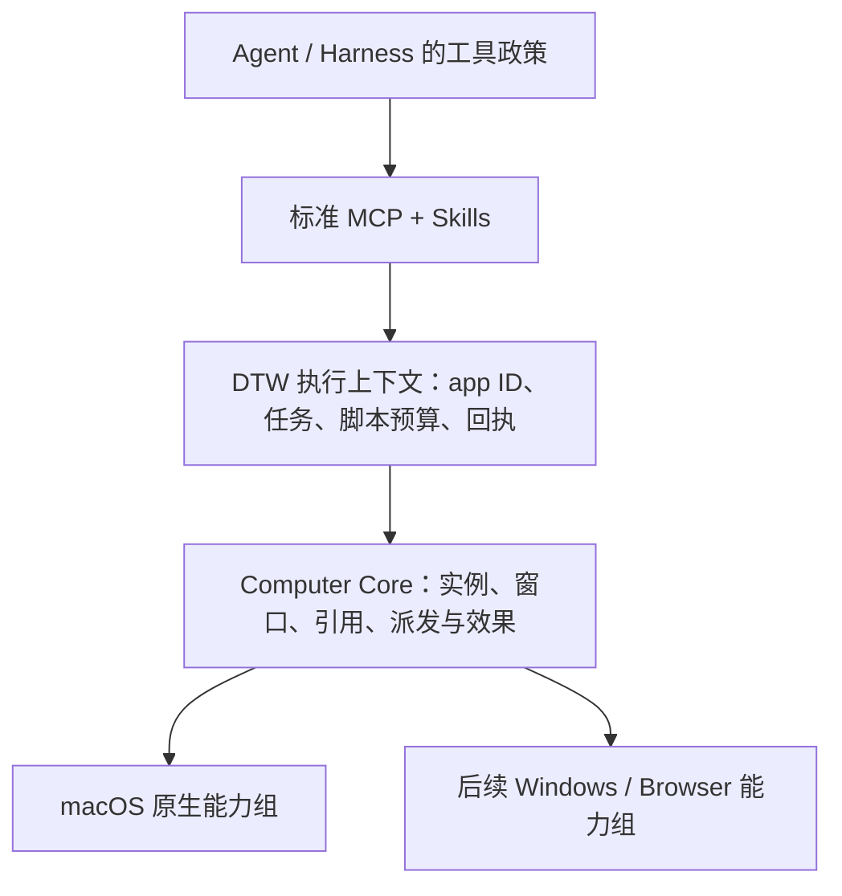

# DTW 架构与演进基线

日期：2026-10-28。#60 完成了 C5 的原生与脚本骨架；本轮按用户明确的工具边界修订接入架构。**DTW 不管理审批和授权。执行只要求平台稳定 app ID 字符串，供 Harness 直接解析；全部交互使用标准 Agent 扩展点。** 这一决定替代 C4/C5 中要求 Host 创建 grant、提供回调或管理授权上下文的设计。

下一 release 只交付重写版。旧 CUA SDK/worker、旧 facade 和旧打包链不恢复。先完成可验证工作流和[产品矩阵](product-matrix.md)，再按实际需要保护稳定行为；日常 CI 保持轻量。

## 固定的方向与可演进的接口

DTW 拥有独立的 Computer Use 类型、执行语义和演进权。CUA 是按能力组选择的源码来源。长期稳定的是应用身份、引用归属、派发与效果语义、资源所有权和生命周期；方法集合、观察字段与平台支持随经过验证的工作流演进。

| 基线 | 固定内容 | 用途 |
| --- | --- | --- |
| 原生与脚本历史证据 | #60，`d0d8279130b74a58496e13b7f6a4c4565f6f00cf` | C5 历史行为和验收记录，不要求兼容旧 Host-grant 接线 |
| CUA 源码来源 | Driver 0.38.0，`85e2b1318bd77ccf3cfa88ccdf875a4bb7eaed19` | 按映射职责迁入，不随 DTW 分发完整 CUA worker |
| 当前接入 | `dtw mcp`，标准 `apps / exec / result` 与 Agent Skills | 普通 Agent 配置即可接入，无 DTW 专用 Host 适配要求 |

## 分层与所有权



| 层 | 职责 | 不属于该层的职责 |
| --- | --- | --- |
| Harness | 工具审批、任务政策、不同工具间的调度 | 不需要实现 DTW grant、回调或续租协议 |
| Agent 接口 | 标准 MCP、app ID、脚本描述、结果/图像、Skill | 不把平台原生 schema 或 token 当公共 API |
| 执行上下文 | 单执行准入、Job、VM、JSON state、预算、取消、回执和清理 | 不作授权决定，不创建授权状态机 |
| Computer Core | 类型化操作、身份/引用校验、能力路由、效果模型 | 不导入 CUA ToolRegistry、SDK Session 或 Manifest |
| 平台能力组 | OS 操作、对象保活、原生证据、线程与资源清理 | 不决定工具审批、不将失败自动切换为另一输入路线 |

一个执行上下文只有一份绑定的 App 实例和引用生命周期。Provider 可以保存 AX/COM 对象以及原生 token，不能自行把目标换成另一个应用。继续使用一个 Cargo package、Rust 内核和已有 Swift 桥；阻塞原生操作留在可终止的私有子进程内。模块边界由依赖与责任体现，不用 crate 数量衡量架构完成度。

## 稳定 app ID 与内部实例绑定

`apps` 返回去重条目 `{app: "com.apple.TextEdit", name: "TextEdit"}`。每次 `exec` 必须提供 `app` 字符串，结果原样回显。macOS 使用 bundle ID；其他平台的稳定标识由对应 provider 明确定义。展示名称不能替代它。

app ID 是目标身份，不是权限 token。DTW 不要求、接收或验证用户审批事实。Harness 直接解析普通 MCP 参数中的 app 字符串；未实现细粒度策略的 Agent 也能正常调用工具。PID、进程出生代际、路径证明和其他内部身份结构不进入模型参数。

```text
apps() -> [{app: 稳定平台 ID, name: 展示名称}] + 方法/schema/限制
exec(app = 稳定平台 ID, request_id, source)
    -> 内部解析唯一可操作运行实例
    -> 注入只绑定该实例的 app 对象
    -> 每次原生调用校验实例、窗口、provider 与 observation
    -> 等待执行收尾，回显 app ID、结果、回执与图像
result(app = 原 app ID, request_id)
    -> 只读原记录，不执行、不解析新实例替代原回执
```

没有隐式默认 app。普通 Chrome helper 不作为独立可操作应用；执行时同一 ID 对应多个独立实例则返回 `ambiguous_app`，不按名称、前台状态或 PID 猜选。应用重启不改变稳定 app ID，但会使旧实例引用失效；state 和观察不能移植到另一个进程。实例绑定是 DTW 内部执行正确性要求，不增加外部参数。

| 概念 | 必须保持的约束 |
| --- | --- |
| `WindowRef` | 绑定应用实例和可核验窗口归属；标题、尺寸或 z-order 只能辅助选择 |
| `ObservationRef` | 绑定 context、app、window、provider、kind、generation 和有效期；像素观察包含尺寸与坐标变换 |
| `Capability` | 描述后端支持和原生执行条件，不表示用户授权 |
| `ActionOutcome` | 分开报告派发状态和效果证据，保留结构化原生错误 |
| 执行期限 | 约束本次操作和脚本的资源占用；不是审批到期或授权续租 |

派发状态为 `not_dispatched / dispatched / unknown`；效果证据为 `confirmed / unverified / mismatch`。`confirmed` 只针对具体后置条件。完成执行不等于完成业务任务。脚本 JSON state 只在成功时提交；已经发生的点击、保存和输入不能回滚。取消、超时或未知效果不触发自动重放。

## 脚本与标准 MCP 生命周期

五个方法 `windows / observe / capture / press / click` 返回 Promise。脚本顺序组合观察、操作与独立读回。脚本不能切换 app、传任意 PID、启动进程或调用任意 native tool；同名多窗仍需消歧。没有文件、网络、进程或模块加载入口。采用 QuickJS/rquickjs，不自造 JavaScript parser。

方法名、参数/结果与能力描述由 Rust 方法定义和 schemas 描述；`dtw api` 从同一 schemas 生成 TypeScript，仓库声明通过生成结果比较保护。结构化观察保留可可靠读取的角色、名称、值、启用状态与动作信息；展示 label 不承担结构化事实来源。后端支持项明确枚举，覆盖范围由后端报告，不由通用协议层写死 AX 或 Windows 细节。

`exec` 等待有界执行结果，调用者不需要实现提交/轮询流程。MCP `notifications/cancelled` 映射到对应活动任务；EOF、断管和父进程退出会收尾原生资源。`result` 用于查询原始回执，包括取消后的记录。跨进程持久回执不在当前合同内；丢失响应时保持效果不明，后续先独立观察。

同一连接单执行准入，只驻留一个 app 执行上下文。切换 app 前完整关闭旧 native owner，避免其闲置 SCK client 继续持有 scene lease；返回原 app 时 state/refs 重建，报告 `context_reset`，原回执仍保留。VM、native worker 和子进程有明确关闭顺序。GUI 施工与验收按物理桌面串行；现有 SCK lease 不充当所有输入的全桌面锁。多个独立工具进程共享物理桌面的协调由调用方负责。

## CUA 迁移单位与 C6 扩展准入

按完整能力组迁入，在同一责任人下确定源文件闭包、状态所有者、绑定路线和关闭顺序。纯机械搬运、类型适配与行为补丁应可分别审查；不能把有状态的操作只当作若干独立函数复制。

| 能力组 | 必须一起处理的依赖 |
| --- | --- |
| 应用/窗口发现 | 身份、出生代际、覆盖范围、空结果与未证明的区分 |
| 应用启动/退出 | 当前 exec 先绑定已运行实例；启动需先定义实例建立前的入口，退出需保留原实例效果回执，不能直接套用窗口动作 |
| AX/UIA 观察与动作 | 精确窗口关联、原生对象保活、结构化元素、action 支持、线程、期限 |
| 截图与像素动作 | 图像坐标、几何、目标身份、遮挡、binding 消费和效果回执 |
| 文本、键盘、滚动、拖拽 | 路由/焦点证据、事件源、修饰键与按下按钮、滚动残量、取消/退出释放 |
| 菜单、focus、helper/modal | 归属证明、动作路线、平台副作用及支持条件 |
| Browser | profile/endpoint、session、tab/frame/ref、origin/文件等显式资源身份与清理 |
| Windows UIA/WGC | COM apartment、provider 阻塞、DPI/图像几何、输入效果与迟到输入 |

每组进入批量施工前先贯通一个真实工作流：源代码映射 → DTW 类型 → 执行上下文 → MCP/schema → 脚本 → 原生操作 → 独立读回。先把这个样板验证清楚，再并行迁移其他闭合能力组。Windows 原生能力需要 Windows 实机证据；macOS 构建或 mock 测试不替代它。

输入组必须明确哪个对象持有事件源、焦点/路由状态、按键/按钮状态和残量，谁在成功、取消、超时、异常和 worker 关闭时释放它。gate 负责准入与 drain，不能成为没有生命周期归属的全局状态容器。

`native-source-provenance.md` 记录 source commit、原始路径/hash、目标路径、依赖闭包、版权/notices、机械改动和行为补丁。每次迁入或更新先对固定 checkout 核验原始 hash，再按能力组评估上游 diff。Rust 到 Swift 的适配需要职责级审查；不能将来源 hash 相同误当成适配行为已经正确。来源校验可以本地轻量运行，不引入全量 CUA CI 编译。

CUA 的 `_AXUIElementGetWindow` 等私有 SPI 必须隔离并明确条件；不能用标题或几何猜测代替精确归属。未选定的 Cursor、录制、Perception、VM、Cloud 等目录不会因复制源码而成为 DTW 能力。

## 验证与交付

保留已有身份、引用、生命周期、效果、IPC 和原生场景的有效测试。对本轮公开合同、标准取消和 app ID 解析与内部实例校验增加针对性保护；CI 不恢复旧 SDK/worker 构建。真实 GUI 验收包含成功独立读回、派发前拒绝、派发后未知以及关闭清理，按具体能力组记录。

标准 MCP＋Skill 接入必须在普通客户端上验证，不以定制 Caelis Host 的历史记录替代。插件本地 staging、源码构建、原生 GUI、签名安装和公开发布分别给出证据。C1–C5 历史说明保留版本边界，新接入不继承旧 grant 流程的结论。

本轮原生与普通 agy/Claude 模型工作流的验证、过程中遇到的失败与范围限制见[当前入口验收](standard-agent-acceptance.md)。
