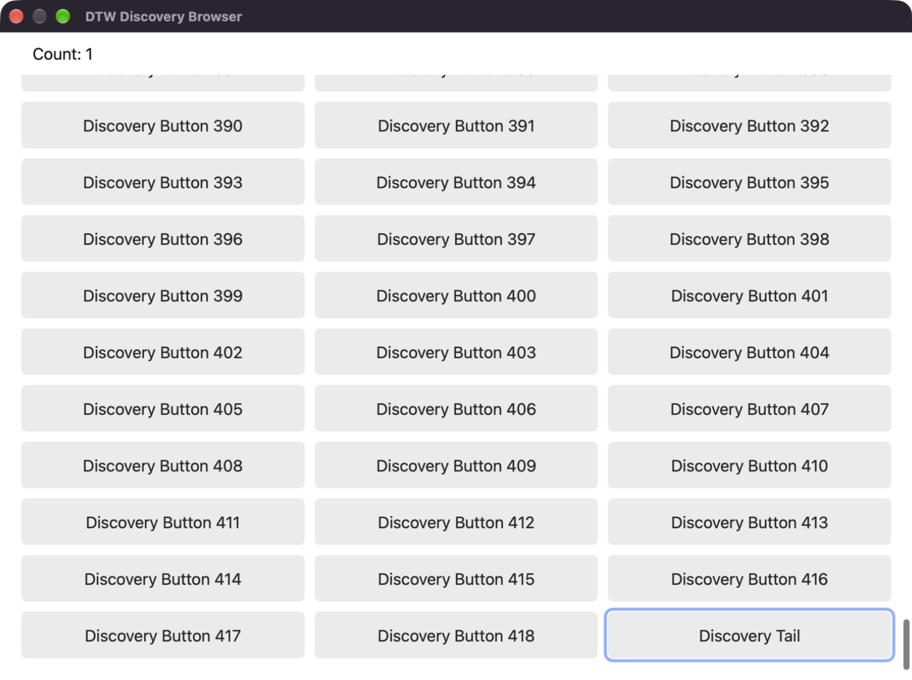
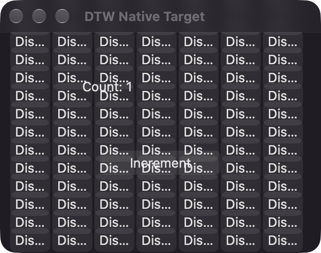

# 原生分页与窗口引用隔离验收

日期：2026-10-28。接续 #63 的 `16c5afd1732e27e38407b601abe26d2012ccd1b8`；#63 仍未合并，本切片以其分支为基线。最终验收源码为 `53ef00473b33f4dc282dcea3d40a963dae8fe3a2`，DTW 二进制 SHA-256 为 `f381cd433ed109c44eb2ad6f8f37485cd0b06f53baf875aae3b6e78d9f39187a`。后续提交只增加本报告与脱敏证据。

本次交付两个相连切片：按窗口及观察类型保留引用，以及在 macOS 原生遍历过程中筛选、分页。公开工具保持 `apps / exec / result`，`exec` 仍只接收 `app + source`。这不是第一大批次全部完成：AX 无关的基础窗口路线、浏览器就绪处理和 API 按需发现仍待继续。

## 实现与合同

- `app.observe({window_ref, role?, text?, limit?})` 创建查询；`app.observe({cursor})` 保留原生 frontier 续页。每页默认 40 个匹配项、最多 100 个，不先收集整树再切片。
- 原生 AXChildren 采用计数加索引范围读取，保留 frontier、visited 和子节点位置。字节边界留下的当前元素缓冲至下一页；节点、边、深度、元数据与会话容量均有界。容量不足不会任意逐出其他查询。
- 同一查询各页共用 observation_ref，早先页的元素仍可使用。另一个窗口的读取、同窗截图、未变化的窗口清单刷新均不再清空其语义引用。新同窗同类型读取替换旧绑定，输入准入消费本窗两种绑定。
- 空页可携带 next；结束也可能 incomplete。已知读取缺口和资源停止保留 coverage.reason。complete 只描述当时暴露的活树遍历，不证明 UI 已就绪或目标不存在。
- Core 保留原有 15 秒观察期限，续页不延长；取消、失败、迟到结果和原始动作回执仍沿原生命周期处理。失效查询及时释放元素映射，不将数千条名称留在 tombstone 中。

接口与例子见[脚本合同](app-script-v1.md)，原生预算与来源见[来源说明](native-source-provenance.md)。原子动作数量仍为五个，没有加入键盘、文本或浏览器 DOM API。

## 自动检查

| 检查 | 结果 |
| --- | --- |
| Cargo `--all-targets --locked --offline` | 225 项库测试、4 项 CLI、3 项真实 macOS stdio 进程测试通过 |
| `scripts/check-source.sh` | 格式与版本一致；52 项 Core、20 项 IPC、12 项 Python 通过 |
| Swift 原生 inventory 纯逻辑控制 | 111 项断言通过；WebKit fixture 以 warnings-as-errors 编译通过 |
| 新增合同回归 | 真实 VM→Host bridge 的过滤/续页，跨页/窗口/类型引用，失败与过期、游标重用、非法组合、容量、回收和晚到效果 |

保持现有两项轻量 CI；没有新增全量 CUA 构建。受控 provider 测试与原生 GUI 证据分别记录。

## AppKit 大树与基础回归

自有原生 fixture 含 420 个可操作 Discovery 按钮。普通 stdio MCP 查询尾部 `Discovery Tail`：4 页，累计 visited 为 125、249、373、428，恰好一个匹配，最终 complete。另一次按每页 25 个查询完整读取 420 个按钮，共 17 页。

完整分页后，再观察另一窗口、截取本窗、刷新窗口库存，仍可按压第一页元素；随后仍可使用另一窗口早先保留的元素。两个动作的独立 fixture 记录恰好为 `Discovery item 000` 和 `Increment`，计数 0→2，没有动作重放。该轮包括准备和退出共 **6.331 秒**。

另一个全新 fixture 回归通过：AX press 0→1、像素 click 1→2；陈旧/跨 app 引用拒绝；原 RPC 重送不新增效果；取消前后计数不变、保留已提交 state 与原记录；A→B→A 保留上下文；两个 MCP 会话独立 state、并发截图与退出清理。共 **8.324 秒**。全部自有 fixture、MCP 和 native workers 正常退出；最终进程清单无本轮残留。

这次没有复现 #63 报告中的额外计数事件，不能据此宣称其历史原因已找到或修复；[原失败记录](compact-exec-acceptance.md#自有窗口-gui)继续保留。

## WebKit：暖态通过，冷启动仍有限制

使用自有 AppKit WKWebView、内嵌离线 HTML 与 420 个按钮。没有访问用户浏览器或网络站点。

两次早期冷启动样本在页面已报告 loaded/ready 后，首次 AX 查询仍只见到 7 个节点，无匹配，coverage.complete=true。探针没有执行输入，计数保持 0，明确记录为未通过。第二次样本的独立后续观察已能返回 heading、计数文本和可按按钮，并带下一页，说明内容树可在后续变得可见；当前证据不能把原因确定为 helper PID 归属。

这两次样本使用 `c6c2d1865f374a99990a7ba02fdcac9b2980e93c` / `cc7cf303bfac7f08320f550db975052b47daef868e6b499d662cb1e44cf78979`。最终源码只进一步更新发现示例及探针显式 warmup 开关，未增加产品侧就绪等待。

最终二进制的暖态实验明确先做一次读取和截图，再进行新的目标查询：4 页访问 437 个节点，唯一找到 Discovery Tail，按压一次，独立 JS 计数和 AX 读回均为 Count: 1。包括准备和退出共 **5.687 秒**。这证明就绪后的 WKWebView 原生分页与语义按压，不证明冷启动自动就绪、Chrome 全面支持或 DOM 接入。



## 普通 Claude Agent

普通 Claude Code + **codex/gpt-6.1-terra**，使用临时 stage 的标准插件、Skill 与 stdio MCP；未修改用户配置，没有定制 Host。

模型收到自然语言任务后调用 **Skill → apps → exec → exec**。两个 exec 都只带 app/source，自行在脚本内筛选和续页，找到唯一启用的 Discovery Tail，按压一次，独立验证 Count 0→1，取得 640×504 PNG。fixture 的 actions_started/clicks 均恰好为 1。没有错误、权限拒绝、额外 result 查询或输入重试。

两次 exec 分别包含 5 和 10 次原子调用；紧凑 JSON 输出为 **697 B + 1019 B = 1716 B**，不含 apps/schema、Skill 文本、MCP 外壳或 PNG。Agent 外层墙钟 **26.667 秒**，CLI 报告 **23.502 秒**，API **22.222 秒**。单次测量不能证明普遍的模型延迟改善。



## 复现与后续

```sh
python3 tests/acceptance/paged_discovery_probe.py --dtw /path/to/dtw --output /tmp/new-appkit-run
python3 tests/acceptance/web_discovery_probe.py --dtw /path/to/dtw --output /tmp/new-cold-run
python3 tests/acceptance/web_discovery_probe.py --dtw /path/to/dtw --output /tmp/new-warm-run --warmup
python3 tests/acceptance/standard_agent_probe.py --dtw /path/to/dtw --output /tmp/new-regression-run --pixel-click
```

原生探针需真实已授权的 macOS GUI；像素回归需自有窗口前台无遮挡。冷态探针若遇到未就绪边界会保存观察和截图，返回失败，不自动按压或重试输入。

[脱敏证据](evidence/paged-discovery-20261028/summary.json)保留源码、二进制、查询页数、独立效果、模型调用与退出信息。完整应用清单、Agent 对话和配置仅留本地；原始目录分别为 `/private/tmp/dtw-paged-gui-release-20261028/`、`dtw-web-warm-final-20261028/`、`dtw-paged-regression-final-20261028/`、`dtw-paged-claude-final-20261028/`，冷启动证据在 `dtw-web-gui-20261028/` 与 `dtw-web-boundary-20261028/`。

后续继续建立 AX 无关 WindowSurface 身份/复用证明，封装浏览器语义就绪，再增加按区域/子树发现与 API 按需说明。当前基础窗口归属仍保留 AX 对象校验；没有宣称 Windows、后台独立输入、不动鼠标、锁屏或公开发行包已经验收。
