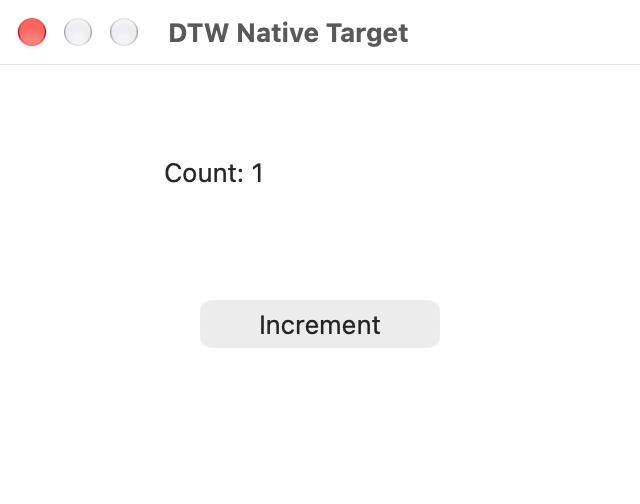

# 官方 rmcp 本地 stdio 验收

日期：2026-10-28。运行代码提交 `2c74ea284acad3e811c34dcff7313a122777e569`；二进制 SHA-256 为 `5e384ddc25512a0108764fffeb8aebda008ff46efcb4d6198141e3422b7a4779`。本报告与脱敏证据在后续文档提交记录，未修改已测运行代码。此前 app/source 和多 app 的证据分别保留在[接口验收](app-source-acceptance.md)与[骨架验收](multi-app-foundation-acceptance.md)。

`dtw mcp` 已复用官方 [rmcp 3.8.0](https://github.com/modelcontextprotocol/rust-sdk/releases/tag/rmcp-v3.8.0)，仅启用 server / transport-io，未引入 HTTP、授权、CUA SDK 或旧 worker。JSON-RPC framing、版本协商、通知和标准工具/图片封装交给 SDK；DTW 保留 app/Core 执行与原回执，以及断流/取消时原生清理。适配层不解析或二次解码脚本文本。

`exec` 的 schema 严格只接受 `app` 与 `source`。调用方不提供执行编号、文件路径或预算；正常调用同步等待。内部保留 30 秒 deadline、VM/回执字节约束，无原生调用次数配额。外部审批仍由 Harness 根据 app 参数自行实现。

## 自动检查

| 检查 | 结果 |
| --- | --- |
| Cargo `--all-targets --locked --offline` | 201 项库测试、4 项 CLI 测试通过；新增真实 stdio 进程测试共 3 项通过 |
| `scripts/check-source.sh` | 版本、格式、41 项 Core、20 项 IPC、12 项 Python 检查通过 |
| 实际 SDK I/O | initialize / 版本协商、2026 metadata 入口、工具 schema、普通结构化错误与图片、脚本文本保真、重复帧、取消、EOF、超大帧、输出错误与停滞均通过 |
| 取消交错 | 清理期间保留 active reservation，旧取消不能关掉后继 catalog reader；重复取消不重入，清理失败阻止新执行；首次与随后读回保留原终态字段 |
| 重复请求 | 多个相同活跃 RPC 帧沿原执行收敛，不重复派发；完成通知唤醒等待者，取消仍终止原执行，SDK 路由只返回原请求的一份响应 |
| 真正的 macOS stdin/stdout | 初始化后 EOF 正常退出；stdin 保持打开但 stdout 断开或无人读取时，进程在限定时间内退出，不被 Tokio 阻塞 I/O 线程拖住 |

完整库/CLI 与新增第三项 stdio 测试分两次运行；后者只增加测试，未改变运行代码。协议负控采用内存 I/O 与受控 mock；进程测试运行真实 `dtw mcp`。它们不替代下面的原生 GUI 与真实模型验证。CI 继续沿用原有两项轻量检查。

## 自有窗口真实 GUI

通过 `tests/acceptance/standard_agent_probe.py --pixel-click` 经普通 MCP stdio 完成，一次通过，含 fixture 准备与清理共 **14.028 秒**：

- AX 发现和一次 press，fixture 自身计数 0→1；完成帧重送不再操作，原回执保持。
- 指定窗口 PNG 640×504；前台、无遮挡窗口的一次坐标 click，独立计数 1→2。
- 取消后保留已提交 state，原生上下文按需重建；A→B→A 保留各 app 的 state 和窗口引用。
- 两个独立 MCP 会话状态隔离，并发对不同 app 完成六次截图；另一会话退出后原会话仍可截图。
- 两个 MCP 及其全部原生 worker、两个 fixture 均正常退出，无强制信号；后续专属路径进程核对无残留。

原始记录位于 `/private/tmp/dtw-rmcp-gui-20261028/`。源码追踪的[脱敏摘要](evidence/rmcp-20261028/summary.json)不收录用户运行中应用清单。

## Claude Code + Skill + MCP

Claude Code **2.1.312**，实际模型 **codex/gpt-6.1-terra**。使用 `scripts/stage-agent-plugin.py` 生成临时插件，经 `--plugin-dir` 和 `--strict-mcp-config` 加载，未修改用户配置，也没有定制 Host。

实际顺序为 **Skill → apps → exec → exec**。两个 exec 入参都只有 `app`、`source`，分别执行 2、4 次原子方法。模型先选窗观察，再观察并筛选唯一可操作按钮、press 一次、重新观察 Count 0→1 并截图。核对了工具参数、原始结果、截图及 fixture 独立计数；操作开始次数和计数均恰为 1，无工具失败、权限拒绝、轮询或重试。

CLI 报告流程 **25.172 秒**，其中 API 时间 **24.315 秒**；外层进程墙钟 **27.225 秒**。这是单次模型验收，不能据此比较纯原生性能或断言 SDK 迁移带来加速。CLI、fixture 正常退出，专属进程无残留。原始记录位于 `/private/tmp/dtw-rmcp-claude-20261028/`。

本轮仅验证自有 macOS 窗口，未重跑 agy、公开发行包、其他平台或真实应用 Space/闭窗矩阵。HTTP/远程、文件输入、简洁默认回执、AX 分页和新的原子能力均未在本次实现；能力矩阵与下一步见[产品矩阵](product-matrix.md)。
